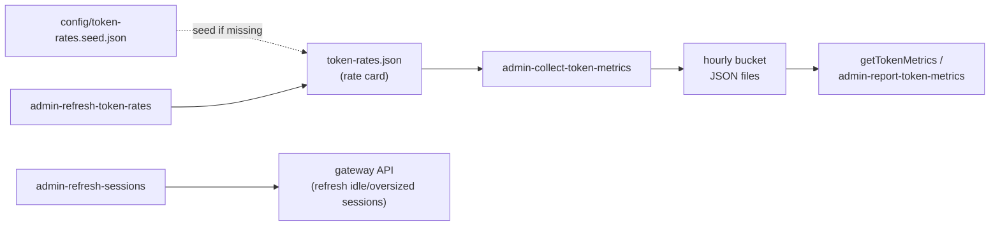

# admin/

Token metrics collection, session cost management, housekeeping (orphaned `.tmp` files, Qdrant health) and the daily [Skill Workshop review](#skill-workshop-review). OpenClaw post-install dist patches are not here: they live in `jeeves` (Decision 36).

## Runnables and modules

| Runnable (module) | Description |
| --- | --- |
| `admin-collect-token-metrics` (`collect-token-metrics.ts`) | Reads OpenClaw usage up to the last closed hour (from the agent SQLite DB on OpenClaw 2026.9+, else the legacy session transcripts), then Claude Code session logs, and writes immutable hourly rollup buckets to disk. Refuses to write when a model is missing from the rate card (records the id in `token-rates.pending.json` and triggers admin-refresh-token-rates, which adds it from OpenRouter) |
| `admin-refresh-sessions` (`session-refresh.ts`) | Rotates bloated gateway sessions by resetting idle sessions with high cacheRead values |
| `admin-report-token-metrics` (`report-token-metrics.ts`) | Prints the cost report for `[--from <date>] [--to <date>]` as JSON ([Querying Costs](#querying-costs)); no manifest, run on demand |
| utility `getTokenMetrics` (`token-metrics.ts`) | Queries pre-rolled hourly buckets and aggregates them into a cost report for a time range; on the root export, never registered |
| `admin-refresh-token-rates` (`refresh-token-rates.ts`) | Seeds the rate card if missing, then refreshes every provider model's $/MTok rates from the public OpenRouter model endpoint (`openrouter.ai/api/v1/model/<id>`, base tier, no LLM). Also adds models the collector recorded as pending (`token-rates.pending.json`). Fetches 4 at a time (15 s per request, 60 s budget), writes changed rates atomically (advancing `updatedAt`), skips internal `openclaw/`/`clawdbot/` entries and entries marked `"manual": true`, and fails if any model can't be resolved (after applying the rest) or the card is missing or invalid. `--dry-run` reports changes without writing |
| `admin-sweep-orphaned-tmp` (`sweep-orphaned-tmp.ts`) | Removes orphaned `.tmp` files left behind by crashed atomic-write operations: scans the content and scripts directories, plus any absolute directories in `jobs.admin-sweep-orphaned-tmp.extraDirs` (Decision 55), recursively (skipping `node_modules/` and `.git/`, and directories that don't exist) for `.tmp` files older than 1 hour, and reports how many it removed. Every directory gets the same rules (`lib/sweep-tmp.ts`). |
| `admin-check-qdrant-health` (`qdrant-health-check.ts`) | Checks Qdrant liveness (`/healthz`, plain-text body, judged by HTTP status) and each collection's status and optimizer state. Attempts a non-interactive restart when Qdrant is down or unhealthy ([below](#qdrant-restart-privileges)). |
| `admin-review-skill-proposals` (`review-skill-proposals.ts`) | Reviews every pending OpenClaw Skill Workshop proposal against the installed skill inventory (one report-only worker), writes a dated report, posts a numbered summary with its insider link and watches the skills catalog's character budget. Applies nothing. Opt-in: needs a `skillReview` block; shipped disabled and dry ([below](#skill-workshop-review)) |
| `admin-regenerate-token-metrics` (`regenerate-token-metrics.ts`) | Rebuilds hourly buckets for `[--from, --to)` from the agent DB plus Claude Code logs, and bootstraps the agent-DB cursor after the 2026.9 upgrade. Modes: `--out DIR` (scratch; refused when DIR is the live store, directly or through a symlink, or already holds buckets in range), live without `--to` (rebuild to the last closed hour, replaces cursors), live with `--to` (counted events only, cursors untouched); `--dry-run`. Live runs need the `OPENCLAW_UPGRADE_CUTOFF` environment variable (see [Regeneration settings](#regeneration-settings)) and refuse a `--from` before it without `--allow-pre-upgrade`; `--out` runs ignore it |

## Data Flow



- **admin-collect-token-metrics** incrementally reads OpenClaw usage (agent DB `~/.openclaw/agents/main/agent/openclaw-agent.sqlite`, read-only, on 2026.9+; legacy JSONL transcripts in `SESSIONS_DIR` otherwise) and Claude Code logs (`~/.claude/projects`), and rolls usage into per-hour bucket files partitioned by channel and model. A fresh instance (no counted OpenClaw usage) starts the DB cursor empty; an upgraded host refuses until `admin-regenerate-token-metrics` bootstraps it.
- **getTokenMetrics** (and the runnable `admin-report-token-metrics`) reads those buckets and the rate card to produce aggregated cost reports.

### Storage

- Buckets: `TOKEN_METRICS_DIR` (`paths.tokenMetricsDir` in the instance config, default `{stateDir}/jeeves-runner/token-metrics`; the `TOKEN_METRICS_DIR` environment variable wins), one file per UTC hour at `<yyyy>/<mm>/<hour>.json`.
- Rate card: `token-rates.json` in that directory ($/MTok per model per token category), seeded from `config/token-rates.seed.json` when missing (never overwritten). `admin-refresh-token-rates` refreshes it from OpenRouter (base tier; prompt-length overrides and 1-hour cache writes ignored) and fails if a model can't be resolved or the card is missing or invalid. Token metrics are estimates; they are normalized against provider billing before invoicing.
- Cursors: runner state namespace `token-metrics`, keys `cursors` (legacy transcripts), `cursors-openclaw-db` (agent DB) and `cursors-claude-code`. A file cursor stops at the first record in the current (still-open) UTC hour, so the next run counts it once the hour closes; without one it stops at the end of the last complete line (an unterminated last line counts only once it parses). Each record is counted exactly once.

### Regeneration settings

`OPENCLAW_UPGRADE_CUTOFF` (environment variable, per instance, **no default**) is the first UTC hour this instance ran OpenClaw 2026.9+, in ISO 8601 (`YYYY-MM-DDTHH:00:00Z`); an instance that never ran an earlier OpenClaw uses its first hour of usage. Hours before it were counted by the legacy JSONL collector and are never rewritten. Only `admin-regenerate-token-metrics` reads it, and only for live runs:

- unset, empty or not a date: a live run (including `--dry-run`) is refused with a message naming the variable, even with `--allow-pre-upgrade`;
- a live `--from` earlier than it is refused unless `--allow-pre-upgrade` is given (owner-approved only);
- `--out` scratch runs never touch the live store (an `--out` that resolves to `TOKEN_METRICS_DIR`, directly or through a symlink, is refused), so they ignore it: no variable or flag is needed to scan pre-upgrade hours into a scratch directory.

It is an environment variable rather than an instance config key because it is a one-off operator setting for a manually run CLI, with no sensible default to ship. `admin-collect-token-metrics`, `admin-report-token-metrics` and the other runnables never read it.

## Querying Costs

Run the runnable `admin-report-token-metrics` through the instance launcher (from any directory):

```bash
node "$JEEVES_SCRIPTS_DIR/bin/jeeves-scripts.js" run admin-report-token-metrics --from 2026-06-01 --to 2026-06-02
```

`--from` / `--to` take ISO 8601 dates or timestamps (`--from <date>` or `--from=<date>`); anything else prints a usage error and exits 1. Without `--from` the report covers everything collected so far, and without `--to` it runs to now, so pass a range when the question is about a period. It prints a JSON `Costs` report (`types/token-metrics.ts`): total `cost`; `models`, keyed `provider/model`, each with `cost`, `costPct` and `tokens`, which holds per category (`input`, `output`, `cacheRead`, `cacheWrite`) `count` / `cost` / `costPct`; `channels` (Slack channels, DMs, heartbeat, subagent, meta-synthesis), each with its name, cost, share and per-model breakdown; and `ref`, the rate card the costs were computed with: per model, the rate for each category in dollars per million tokens, for every model in the card whether or not it was used in the range. `ref` holds prices, not usage; token counts are `models[model].tokens[category].count`. `getTokenMetrics({ from, to })` is the importable form (root export): each bound is a `Date` or an ISO 8601 string, both optional, and the hours containing them are included.

- **admin-refresh-sessions** polls active sessions and refreshes any that exceed the cacheRead threshold after being idle long enough.

## Prerequisites

Most jobs need only the local filesystem and the gateway. `admin-check-qdrant-health` needs the Qdrant service (`integrations.qdrant`); `admin-refresh-token-rates` (and the refresh `admin-collect-token-metrics` triggers for unknown models) reaches OpenRouter over HTTPS.

`admin-refresh-sessions` reads three environment variables, all optional: `CACHE_READ_THRESHOLD` (last-turn cache-read tokens before a session counts as large; default 150000), `IDLE_MINUTES` (minutes since the last message; default 60) and `EXCLUDED_SESSION_KEYS` (comma-separated session keys never refreshed). Set them in the runner job's `env` (a `jobs.admin-refresh-sessions.env` delta). It writes `sessions.json` once per run; when that write fails it renames every rotated transcript back and fails the run, and it notifies the sessions only after the write.

| Runnable                       | Schedule                           |
| ------------------------------ | ---------------------------------- |
| `admin-collect-token-metrics`  | Every 97 min                       |
| `admin-refresh-sessions`       | Every 23 min                       |
| `admin-refresh-token-rates`    | Daily 05:37 UTC                    |
| `admin-sweep-orphaned-tmp`     | Every 59 min                       |
| `admin-check-qdrant-health`    | Every 4 h                          |
| `admin-review-skill-proposals` | Daily 06:00 UTC (shipped disabled) |

The sweep reads `paths().contentDir`, `paths().scriptsDir` and `jobs.admin-sweep-orphaned-tmp.extraDirs` from the instance config when it runs. `extraDirs` lists other directories to sweep with the same rules, as absolute paths (for example a workspace where another tool writes atomically):

```json
{ "jobs": { "admin-sweep-orphaned-tmp": { "extraDirs": ["D:/workspace"] } } }
```

All six entries in core's manifest `jobs/admin.json` have `"prerequisite": null`; `admin-review-skill-proposals` is the one shipped with `"enabled": false`. `admin-regenerate-token-metrics` is registered without a manifest (run it by hand, see the [runbook](./token-metrics-runbook.md)). `admin-refresh-token-rates` uses the RRStack schedule `{"freq":"daily","byhour":5,"byminute":37,"timezone":"UTC"}`.

## Qdrant restart privileges

`admin-check-qdrant-health` runs as the unprivileged runner user. On Linux it restarts the unit named by `integrations.qdrant.serviceName` with `systemctl --no-ask-password restart <unit>` (on Windows, `Restart-Service <name>`), so it never waits on a polkit prompt. No sudoers or polkit rule for the Qdrant unit is assumed (the jeeves-tools polkit rule covers only `jeeves-*.service`). When the restart is denied, the job logs `qdrant down; restart requires operator` (or `qdrant unhealthy; …`) and exits non-zero, so the runner records an error for an operator to act on. Any other restart failure also exits non-zero.

## Skill Workshop review

`admin-review-skill-proposals` reviews the pending OpenClaw Skill Workshop proposals once a day and reports. It never applies, rejects or edits a proposal: every proposal stays pending for a person. The script gathers, checks, delivers and posts; one report-only worker judges.

**Config.** A top-level `skillReview` block ([config.md](./config.md#shape)): `reportChannel`, `timezone` and `serverKey` are required; `reportAccount` (default `default`), `outputDir` (default the report channel's `slack.channels.<id>.homeDir`) and `budgetAlertPercent` (default 90) are optional. No block: the run logs `[skip] no skillReview block in the instance config` and exits 0. A present block that is invalid, or a `reportAccount` the gateway has no Slack bot for, fails `config check`, `doctor` and the run; a directory that is not absolute on this host fails the run and `doctor`.

**Gather (script, no LLM).** The pending proposals through the gateway's `skill_workshop` tool (`list`, then `inspect` each). Artifact texts come from the Workshop store (`<openclawStateDir>/skill-workshop/proposals/<id>/generations/<gen>/`), choosing the generation whose PROPOSAL.md SHA-256 matches the proposal's draft hash and checking each file's size; failing that, `inspect`'s inline text when it fits; else the artifact is marked missing. Fifty listed (the tool's maximum) logs a `[warn]`; the rest wait for the next run. A listed id that is not one safe path segment (letters, digits, `.`, `_`, `-`, not dots alone) fails the run. The skill inventory is every directory holding a `SKILL.md` under every agent's Workshop skills, `skills.load.extraDirs`, `<openclawStateDir>/skills`, `<openclawStateDir>/plugin-skills`, each workspace's `skills/` and OpenClaw's bundled skills, each labelled with its origin (`jeeves`, `jeeves-tools`, `jeeves-scripts-core`, `openclaw-bundled`, the Workshop or the root kind).

**Checks (script).** Per proposal: a description over 160 chars (a Jeeves convention that keeps the skills catalog small, not an OpenClaw limit), support files using `child_process`, other pending drafts for the same skill, the live skill an update targets and whether it changed after the draft (revert risk), and same-named skills elsewhere.

**Snapshot.** `{stateDir}/admin/skill-review/runs/<YYYYMMDD-HHMMSS>/`: `INDEX.md`, `snapshot.json`, `proposals/<id>/` (artifacts and `LIVE-SKILL.md`) and `inventory/<origin>/<name>.md`. The newest 14 runs are kept; they are disposable.

**Report contract.** The worker writes only `report.md` in the run directory: one `### <id>` section per proposal with `**Disposition:**` (Approve as is; Approve with modifications, which includes a hoist to a shared skill in `jeeves`, `jeeves-tools` or `jeeves-scripts-core`; Reject or decline; Not reviewed), `**Short description:**` and `**Recommendation:**`. It is dispatched with no Slack post targets and never calls `skill_workshop`. A missing or invalid report fails the run before anything is delivered or posted.

**Deliver and post.** The report's insider link is resolved before the worker runs, by jeeves-server's local API with the machine key `serverKey` names; a live run the server can't link fails there, before a worker is spent. The report, plus a `## Skills catalog budget` section, goes to `<outputDir>/<YYYY-MM-DD>.md` (the date in `timezone`; a second run the same day replaces it). The Workshop is then re-gathered: proposals decided since the review are left out and counted, ones revised or created since are listed under "Not yet reviewed", and a failed or capped re-gather posts the review's snapshot and says so. The summary goes to `reportChannel` as `reportAccount`'s bot: a line saying nothing was applied, the link, every proposal in one continuously numbered list grouped by disposition, each line naming the skill, new or update, and the proposal id (its first 8 chars, or the whole id when shorter, lengthened until no other id in the post starts with it), then the catalog budget lines. It is built by the script, never the worker's words.

**Answering the post.** Reply in words such as "apply all except #5". The numbers are the post's: each maps to the id shown on its line, which is the whole proposal id or a prefix of it. Before any `skill_workshop` call, resolve it against the pending proposals (`skill_workshop list`): the proposal whose id equals it, else the one whose id starts with it; if none or several match, ask. The proposals are applied, rejected or edited only by that answer.

**Catalog budget.** The gateway's `skills.status` for its default agent, rebuilt with OpenClaw 2026.9.6's `<available_skills>` formatter and fitted to the limits in `openclaw.json` (the agent's `skillsLimits.maxSkillsPromptChars`, from `agents.entries` when present, else `agents.list`; else `skills.limits.maxSkillsPromptChars`; else 18,000; `skills.limits.maxSkillsInPrompt` caps the count). It reports the catalog's chars against the budget, the headroom (chars and percent, one decimal, never rounded to 100%), whether the compact format or the count cap is in force, the descriptions over 160 chars with their total excess and the five longest with owners, and the smallest model context whose one-fifth share holds the catalog. Every size is in chars (UTF-16 code units), as OpenClaw measures the prompt; the 160 limit is the same Jeeves convention the checks use. Exactness: OpenClaw keeps a managed skill path (the agent's Workshop skills, `<configDir>/skills`, `<configDir>/plugin-skills`) absolute when it lies outside the OS home, where the port shortens it to `~/`; the measure is exact when OpenClaw's config directory is under the OS home (the default). A later OpenClaw that changes the format or limits needs a re-port. A measuring failure warns and reads "unavailable"; it never blocks the post.

**Quiet day.** With nothing pending the run logs `[skip] admin/review-skill-proposals: no pending Workshop proposals` and writes no snapshot, starts no worker and posts no review. It still measures the budget and posts a short alert to `reportChannel` only when the catalog uses at least `budgetAlertPercent` of its budget (compared at the one-decimal share the alert shows) or is already cut (compact format, or skills left out by the count cap), with a fix to try. Otherwise, or when measuring fails, it logs and posts nothing.

**Flags.** Without `--live` the run gathers and writes the snapshot (read-only elsewhere), measures the budget, resolves the link (warning on failure) and logs what it would dispatch, deliver and post; it starts no worker. `--live` dispatches the worker, delivers the report and posts. `--print-task` prints the worker's TASK and delivers and posts nothing. On a quiet day a run without `--live`, or with `--print-task`, logs the alert and its target and posts nothing.

**Enabling.** The manifest ships disabled with no arguments (a dry run). Set the `skillReview` block (`config set`), then enable the job with a delta that adds `--live`:

```json
{
  "jobs": {
    "admin-review-skill-proposals": { "enabled": true, "args": ["--live"] }
  }
}
```

## Documentation

- [Token Metrics Operational Runbook](./token-metrics-runbook.md) — pipeline stages, recalculation procedures, troubleshooting

## Key Files

| File | Purpose |
| --- | --- |
| `lib/bucket-io.ts` | Hourly bucket file I/O — read, write, merge, flush |
| `lib/channel-mapper.ts` | Maps session transcripts to channel keys (Slack, DM, heartbeat, subagent, meta-synthesis) from transcript text |
| `lib/channel-names.ts` | `ChannelResult`, Slack channel-name registry, Slack channel extraction, `slugify` |
| `lib/subagent-label.ts` | Meta-synthesis phase and granular subagent label detection |
| `lib/transcript-text.ts` | Extracts text chunks from session JSONL lines |
| `lib/openclaw-db/channel-from-meta.ts` | 2026.9+ channel keys from recorded session metadata; text rules only as fallback; sanitized |
| `lib/openclaw-db/schema-v24.ts` | Schema 24 (OpenClaw 2026.9.33): the schema-23 reader under version 24; 24 adds `session_nodes.snapshot_revision` and `session_entry_snapshots`, which token metrics doesn't read |
| `lib/openclaw-db/schema-v23-meta.ts` | Loads schema-23 session keys and channel/peer/label names (read-only) |
| `lib/regen-guard.ts` | Live regenerate guard: refuses when `OPENCLAW_UPGRADE_CUTOFF` is unset or invalid, and a `--from` before it without `--allow-pre-upgrade` |
| `lib/regen-run.ts` | admin-regenerate-token-metrics orchestration: scratch / live / bounded (`--to`, counted-only, cursors untouched), backup → delete → flush → cursor replace; refuses a scratch `--out` that is the live store |
| `lib/sweep-tmp.ts` | `sweepDir` / `sweepDirs`: removes `.tmp` files older than 1 hour under each directory, recursively (skipping `node_modules/` and `.git/`); admin-sweep-orphaned-tmp's body |
| `lib/same-path.ts` | `isSamePath(a, b)`: same location after following symlinks (nearest existing ancestor for paths not created yet); keeps `--out` off the live store |
| `lib/collect-run.ts` | admin-collect-token-metrics orchestration; loads the agent-DB collector (node:sqlite) lazily |
| `lib/fresh-openclaw-history.ts` | Fresh-instance check: with no DB cursor, the collector starts it empty only when no legacy cursor entry and no bucket holding OpenClaw usage exist; otherwise it refuses until regenerate bootstraps it |
| `lib/token-metrics-state.ts` | Runner-state port for the token-metrics namespace |
| `lib/bucket-maintenance.ts` | Bucket backup (`.backup-<ts>.json`, never overwritten) and deletion for rebuilds |
| `lib/claude-code-session-scan.ts` | Claude Code usage scan with byte cursors (stop at the open hour); `countedOnly` for bounded rebuilds |
| `lib/jsonl-cursor.ts` | Byte-span line walking and the resume-offset rule shared by both session scanners: resume at the first open-hour record, else after the last complete line (an unterminated last line only once it parsed) |
| `lib/dm-names.ts` / `lib/dm-name-sources.ts` | Name `slack:dm:<USERID>` channels via the `people` config (configured name when one person owns the id, never cached; [config.md](./config.md#people)) → cache → Slack user map → gateway `member-info` |
| `lib/openclaw-db/schema-v23-payloads.ts` | Schema-23 payload decoding and integrity checks (hot rows, cold and deleted/reset archives) |
| `lib/claude-code-scanner.ts` | Scans Claude Code session JSONL files for Anthropic usage records |
| `lib/rate-card.ts` | Token rate card loader and cost calculator ($/MTok) |
| `lib/rate-card-schema.ts` | Zod schema and validating file reader for the rate card (optional per-entry `manual` flag) |
| `lib/rate-card-seed.ts` | Seed-if-missing: copies `config/token-rates.seed.json` into place, never overwrites |
| `lib/refresh-rates-run.ts` | admin-refresh-token-rates orchestration: read card, fetch rates (skipping `manual` entries), apply changes, write, re-validate, prune the pending file; decides job success |
| `lib/refresh-rates-fetch.ts` | Bounded OpenRouter fetching: concurrency limit and overall time budget |
| `lib/openrouter-pricing.ts` | OpenRouter single-model price fetch and per-token → $/MTok conversion |
| `lib/rate-card-pending.ts` | Pending-models file (`token-rates.pending.json`): ids the collector found missing from the card, handed to admin-refresh-token-rates to add |
| `lib/hour-range.ts` | Hour enumeration and cursor reset for a regeneration range (regen-run) |
| `review-skill-proposals.ts` | admin-review-skill-proposals: flags, prerequisite (no block: skip), `doctor` check; [Skill Workshop review](#skill-workshop-review) |
| `skill-review/settings.ts` / `skill-review/live.ts` | The settings from the `skillReview` block (report directory, posting account, host paths) and the live side effects (gateway, skill roots, run directories, worker, link, post) |
| `skill-review/proposals.ts` | Pending proposals through `skill_workshop` (`list`, `inspect`); artifact texts from the Workshop store, hash- and size-checked, contained |
| `skill-review/inventory.ts` / `skill-review/origins.ts` / `skill-review/skill-fs.ts` / `skill-review/frontmatter.ts` | The skill roots, each skill's origin by package or root kind, the filesystem seam and a SKILL.md frontmatter reader |
| `skill-review/checks.ts` | Per-proposal mechanical checks: description bytes, `child_process`, duplicate drafts, the live skill and revert risk |
| `skill-review/snapshot.ts` / `skill-review/snapshot-render.ts` | The run directory's snapshot (`INDEX.md`, `snapshot.json`, proposals, inventory) |
| `skill-review/task.ts` / `skill-review/report.ts` | The worker's TASK and the report contract it is held to |
| `skill-review/review.ts` | The flow: settings, gather, quiet day, snapshot, link, dispatch, deliver, reconcile, post |
| `skill-review/reconcile.ts` / `skill-review/slack-post.ts` | Re-gather before posting; the numbered summary and the quiet-day alert |
| `skill-review/catalog-format.ts` / `skill-review/catalog-limits.ts` | The port of OpenClaw 2026.9.6's (`eb377ac`) `<available_skills>` format and budget fitting |
| `skill-review/catalog-budget.ts` / `skill-review/catalog-budget-render.ts` / `skill-review/skills-status.ts` | The budget from the gateway's `skills.status`, its post lines and report section |
| `lib/resolve-openclaw-dist.ts` | Resolves the global npm openclaw install (its `openclaw.mjs`, for gateway RPC in `lib/gateway-rpc.ts`) |
| `lib/session-scanner.ts` | Session file scanning with cursor management (stop at the open hour) and range filtering (collector and regeneration) |
| `lib/usage-parser.ts` | OpenClaw transcript line parser and usage normalizer (collector and regeneration) |
| `types/token-metrics.ts` | Shared types across collector and query layers |
