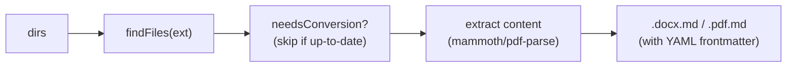

# convert/

Utilities for converting DOCX and PDF files to Markdown with YAML frontmatter, on the root export.

## Scripts

| Script | Description |
| --- | --- |
| `docx-to-md.ts` | `convertDocxToMd(dirs)`: converts `.docx` files to Markdown via mammoth HTML extraction. |
| `pdf-to-md.ts` | `convertPdfToMd(dirs)`: converts `.pdf` files to Markdown via pdf-parse text extraction (page count in `pages`). |

```ts
import { convertDocxToMd, convertPdfToMd } from '@karmaniverous/jeeves-scripts-core';

const { converted, skipped, failed } = await convertPdfToMd(['/base/content/docs']);
```

Each resolves to `{ converted, skipped, failed }` and logs one line per file (`CONVERT`, `SKIP`, `FAIL`) and a summary. A file that fails is logged and counted, never thrown.

## Data Flow



- Both take the directories to scan recursively (missing ones are skipped).
- Output files are written alongside the source (e.g., `report.docx` → `report.docx.md`).
- Staleness checking: skips files whose `.md` output is newer than the source.
- They are utilities, not runnables: there is no `run convert-*` (whether they get thin runnable wrappers is Q23).

## Prerequisites

No external prerequisites. Uses bundled npm dependencies (`mammoth`, `pdf-parse`).

## Key Files

| File | Purpose |
| --- | --- |
| `lib/convert-files.ts` | `convertFiles()`: the find, skip, extract and write loop both utilities share |
| `lib/convert-utils.ts` | Shared utilities - `findFiles()`, `needsConversion()`, `writeMdFile()` (frontmatter values JSON-quoted via `lib/frontmatter.ts`) |
| `lib/pdf-text.ts` | `extractPdfText()`: pdf-parse text and page count; the parser is destroyed even when extraction fails |
