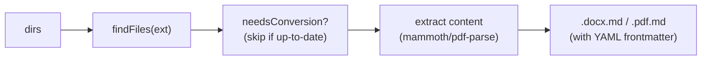

# convert/

Utilities for converting DOCX and PDF files to Markdown with YAML frontmatter, on the root export, and two thin runnables that convert one file each.

## Scripts

| Script | Description |
| --- | --- |
| `docx-to-md.ts` | `convertDocxToMd(dirs)`: converts `.docx` files to Markdown via mammoth HTML extraction. |
| `pdf-to-md.ts` | `convertPdfToMd(dirs)`: converts `.pdf` files to Markdown via pdf-parse text extraction (page count in `pages`). |
| `convert-docx-to-md.ts` | The runnable `convert-docx-to-md <in> <out>` (no manifest). |
| `convert-pdf-to-md.ts` | The runnable `convert-pdf-to-md <in> <out>` (no manifest). |

```ts
import {
  convertDocxToMd,
  convertPdfToMd,
} from '@karmaniverous/jeeves-scripts-core';

const { converted, skipped, failed } = await convertPdfToMd([
  '/base/content/docs',
]);
```

Each resolves to `{ converted, skipped, failed }` and logs one line per file (`CONVERT`, `SKIP`, `FAIL`) and a summary. A file that fails is logged and counted, never thrown.

## Runnables

To convert one file without writing code, run a thin runnable with the input file and the Markdown file to write:

```bash
node $JEEVES_SCRIPTS_DIR/bin/jeeves-scripts.js run convert-pdf-to-md /base/content/docs/spec.pdf /base/content/docs/spec.pdf.md
node $JEEVES_SCRIPTS_DIR/bin/jeeves-scripts.js run convert-docx-to-md report.docx report.md
```

Each takes exactly `<in> <out>` (anything else fails the run: a `CRASH` line with the usage error on stderr, exit 1), writes `<out>` with the same frontmatter as the utilities (`source`, `converted`, and `pages` for a PDF), overwriting it, and exits 1 when the input can't be read or converted. Neither has a manifest; an instance that wants one scheduled adds a manifest in its own `jobs/*.json` ([jobs.md](jobs.md)).

## Data Flow



- Both take the directories to scan recursively (missing ones are skipped).
- Output files are written alongside the source (e.g., `report.docx` → `report.docx.md`).
- Staleness checking: skips files whose `.md` output is newer than the source.
- The utilities scan directories and skip up-to-date outputs; the runnables convert exactly the one file named and always write it.

## Prerequisites

No external prerequisites. Uses bundled npm dependencies (`mammoth`, `pdf-parse`).

## Key Files

| File | Purpose |
| --- | --- |
| `lib/convert-files.ts` | `convertFiles()`: the find, skip, extract and write loop both utilities share; `convertFile()` and `convertFileArgs()` for the runnables |
| `lib/convert-utils.ts` | Shared utilities - `findFiles()`, `needsConversion()`, `writeMdFile()` (frontmatter values JSON-quoted via `lib/frontmatter.ts`) |
| `lib/pdf-text.ts` | `extractPdfText()`: pdf-parse text and page count; the parser is destroyed even when extraction fails |
