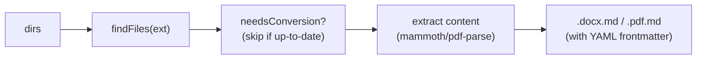

# convert/

Utilities for converting DOCX and PDF files to Markdown with YAML frontmatter and for rendering PDF pages to PNG, on the root export, and three thin runnables that convert one file each.

## Scripts

| Script | Description |
| --- | --- |
| `docx-to-md.ts` | `convertDocxToMd(dirs)`: converts `.docx` files to Markdown via mammoth HTML extraction. |
| `pdf-to-md.ts` | `convertPdfToMd(dirs)`: converts `.pdf` files to Markdown via pdf-parse text extraction (page count in `pages`, text-less pages in `textlessPages`). |
| `pdf-to-png.ts` | `renderPdfPages(input, outDir, options)`: renders selected pages of a PDF to PNG files (Decision 83.1). |
| `convert-docx-to-md.ts` | The runnable `convert-docx-to-md <in> <out>` (no manifest). |
| `convert-pdf-to-md.ts` | The runnable `convert-pdf-to-md <in> <out>` (no manifest). |
| `convert-pdf-to-png.ts` | The runnable `convert-pdf-to-png <in> <outDir> [--pages <list>] [--scale <n>]` (no manifest). |

```ts
import {
  convertDocxToMd,
  convertPdfToMd,
} from '@karmaniverous/jeeves-scripts-core';

const { converted, skipped, failed } = await convertPdfToMd([
  '/base/content/docs',
]);
```

Each resolves to `{ converted, skipped, failed }` and logs one line per file (`CONVERT`, `SKIP`, `FAIL`) and a summary. A file that fails is logged and counted, never thrown.

### Text-less pages

A PDF page with fewer than 20 non-whitespace characters of extractable text (a scanned or image-only page) is listed, 1-based, in a `textlessPages` frontmatter field, for example `textlessPages: [2,5]`, and in one warning on stderr naming the file: `WARN <file>: text-less pages 2, 5 (fewer than 20 non-whitespace characters; scanned or image-only?)`. The field is omitted when every page has text. The conversion still succeeds (Decision 83.2): the Markdown holds the text the other pages have. `convertPdfToMd` and `convert-pdf-to-md` both do this. Read the listed pages as images (`convert-pdf-to-png`) or with OpenClaw's `pdf` tool ([below](#reading-pdfs-from-a-session)).

### Rendering pages

`renderPdfPages(input, outDir, { pages?, scale? })` renders pages with pdf-parse's `getScreenshot` (canvas from `@napi-rs/canvas`, a pdf-parse dependency; no system packages) and writes `<outDir>/<input basename>-p<N>.png`, the basename without its extension (`spec.pdf` page 3: `spec-p3.png`). It creates `outDir` and overwrites existing files, and resolves to the pages written, ascending: `{ page, file, width, height }`.

- `pages`: a 1-based page list such as `'1-3,7'` (comma-separated pages and inclusive ranges, duplicates ignored), or page numbers (`[1, 3]`); default every page.
- `scale`: 1 renders 72 pixels per inch (a US Letter page is 612 x 792); default 1.5. Raise it for small print.

It throws, writing nothing, on an invalid page list or scale, an unreadable or malformed input, or a page outside the document (`Page list 2-4 is outside the document (3 pages)`). The parser is destroyed either way.

```ts
import { renderPdfPages } from '@karmaniverous/jeeves-scripts-core';

const pages = await renderPdfPages('/base/content/docs/spec.pdf', '/base/tmp', {
  pages: '1-3,7',
});
```

## Runnables

To convert one file without writing code, run a thin runnable:

```bash
node $JEEVES_SCRIPTS_DIR/bin/jeeves-scripts.js run convert-pdf-to-md /base/content/docs/spec.pdf /base/content/docs/spec.pdf.md
node $JEEVES_SCRIPTS_DIR/bin/jeeves-scripts.js run convert-docx-to-md report.docx report.md
node $JEEVES_SCRIPTS_DIR/bin/jeeves-scripts.js run convert-pdf-to-png /base/content/docs/spec.pdf /base/tmp/spec --pages 1-3,7 --scale 2
```

`convert-pdf-to-md` and `convert-docx-to-md` each take exactly `<in> <out>` (anything else fails the run: a `CRASH` line with the usage error on stderr, exit 1), write `<out>` with the same frontmatter as the utilities (`source`, `converted`, and `pages` and `textlessPages` for a PDF), overwriting it, and exit 1 when the input can't be read or converted. A PDF with text-less pages still exits 0, with the warning on stderr.

`convert-pdf-to-png <in> <outDir> [--pages <list>] [--scale <n>]` renders with `renderPdfPages` and prints one line per page: `RENDER <in> page <N> -> <file> (<width>x<height>)`. A usage error (not exactly `<in> <outDir>`, an invalid `--pages`, or a `--scale` that is not a positive number: `Invalid scale <n>: use a positive number`, a blank value read as 0), an unreadable input or a page list outside the document fails the run (exit 1).

None of them has a manifest; an instance that wants one scheduled adds a manifest in its own `jobs/*.json` ([runnables.md](runnables.md)).

## Reading PDFs from a session

OpenClaw's `pdf` and `view_image` tools read only files in the agent workspace and in OpenClaw's own media and temp directories. No config setting widens that (`tools.fs.workspaceOnly: false` doesn't, and there is no setting for extra roots), so a PDF in the corpus is out of their reach as it stands. The runnables read any path, so a session picks one of three routes; the core skill `jeeves-pdf` names them:

| Need | Route |
| --- | --- |
| The text | `convert-pdf-to-md`, then read the Markdown. Pages listed in `textlessPages` need one of the other routes. |
| Layout or visuals | `convert-pdf-to-png` with `outDir` in the workspace or OpenClaw's media directory, then `view_image` on each page image. |
| Analysis, or scanned pages read as text | Copy the PDF into the workspace and use the `pdf` tool. |

## Data Flow



- Both take the directories to scan recursively (missing ones are skipped).
- Output files are written alongside the source (e.g., `report.docx` → `report.docx.md`).
- Staleness checking: skips files whose `.md` output is newer than the source.
- The utilities scan directories and skip up-to-date outputs; the runnables convert exactly the one file named and always write it.

## Prerequisites

No external prerequisites. Uses bundled npm dependencies (`mammoth`, `pdf-parse`, and pdf-parse's `@napi-rs/canvas` for rendering).

## Key Files

| File | Purpose |
| --- | --- |
| `lib/convert-files.ts` | `convertFiles()`: the find, skip, extract and write loop both utilities share; `convertFile()` and `convertFileArgs()` for the runnables |
| `lib/convert-utils.ts` | Shared utilities - `findFiles()`, `needsConversion()`, `writeMdFile()` (frontmatter values JSON-quoted via `lib/frontmatter.ts`) |
| `lib/pdf-text.ts` | `extractPdfText()`: pdf-parse text, page count and per-page text; the parser is destroyed even when extraction fails |
| `lib/pdf-render.ts` | `renderPdf()`: pdf-parse page count and screenshots of the selected pages; the parser is destroyed even when selection or rendering fails |
| `lib/page-list.ts` | `parsePageList()` and `selectPages()`: the 1-based page list and its check against the page count |
| `lib/fixtures/*.pdf` | Test PDFs, built byte for byte by `lib/pdf-fixture.test-helper.ts` (regenerate with `npx tsx scripts/write-pdf-fixtures.ts` in `packages/core`) |
