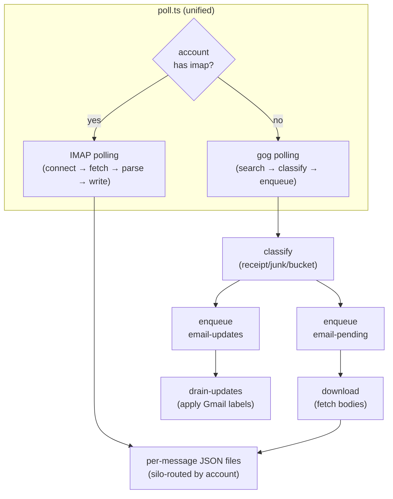

# email/

Unified email pipeline. Dispatches by account type: accounts with an `imap` block are polled via direct IMAP connection; accounts without are polled via the `gog` CLI (Gmail, via an OAuth client or service-account mailboxes).

## Directory Structure

```
email/
  poll.ts                  ← unified entry point (dispatches by account type)
  email-cache.ts           ← shared: per-thread JSON cache
  email-state.ts           ← shared: per-thread/account state in runner SQLite
  imap/                    ← platform-agnostic IMAP transport
  google-workspace/        ← gog CLI transport (Gmail)
  google-workspace/respond.ts   ← assistant-mailbox auto-reply (email-respond job)
  google-workspace/respond/     ← auto-reply qualification, state, TASK, orchestration
```

## Data Flow



## Transports

`poll.ts` takes every account with `emailPolling: true` and routes it by the presence of an `imap` block (not by `type`):

| Transport | Selected when | Steps | Code |
| --- | --- | --- | --- |
| gog (Gmail API) | no `imap` block | Poll (search) → Classify → Enqueue → Download → Drain (apply labels) | `google-workspace/`, via `../lib/gog.ts` (retry wrapper around the `gog` binary) |
| IMAP | `imap` block present | Connect → Fetch (UID watermark) → Parse MIME → Write, in one step | `imap/` (`imapflow` + `mailparser`; no external binary) |

- **gog poll:** each run searches `in:anywhere` (so spam and trash are included and human actions there are visible) and takes the newest 100 threads per account. Every thread is classified and its thread state updated; a thread that is new or updated (more messages or a newer date) **and** looks important (labelled `INBOX` or `UNREAD`, a receipt candidate, or in a bucket listed in `buckets.priority`) is deep-fetched (`email-fetch.ts`): full metadata into the thread cache, label-change provenance, curation signals, and new messages enqueued on `email-pending` for `download`.
- **IMAP poll:** per folder, fetches messages above the stored UID, parses them and writes the files directly (see [imap/](#imap)). An error on one IMAP account is logged and the other accounts are still polled.
- Both transports write the same layout (see [Output Format](#output-format)).

## Runner Jobs

| Job | Script | Schedule |
| --- | --- | --- |
| `email-poll` | `poll.ts` | Every 11 min |
| `email-download` | `google-workspace/download.ts` | Every 13 min |
| `email-drain-updates` | `google-workspace/drain-updates.ts` | Every 17 min |
| `email-backfill-historical` | `google-workspace/backfill-historical.ts --live` | Hourly; needs `emailConfig.backfill` |
| `email-respond` | `google-workspace/respond.ts` | Every 3 min; needs an operator-configured `emailConfig.respond` (never auto-registered) |

Core's manifest (`jobs/email.json`) is authoritative; an instance adjusts it with `jobs.<id>` deltas. `email-inventory` is registered without a manifest. All five entries carry a non-null `prerequisite` (gog credentials or IMAP, plus `emailConfig.backfill` for the backfill and an operator-configured `emailConfig.respond` for the auto-reply, which `sync-jobs` never registers on its own).

### Historical backfill

`email-backfill-historical` runs `backfill-historical.ts --live` (the manifest passes `--live` in `args`; a manual run without it is a dry run). Each run searches one window per account (all result pages), walking back from the newest unprocessed point until the lookback limit, then does nothing.

- Settings come only from `pipeline.emailConfig.backfill` in the instance config (`accounts`, `lookbackDays`, `windowDays`, all required) or the CLI overrides `--accounts` / `--lookback-days` / `--window-days` (per field, CLI wins). There are no defaults: a missing setting fails the run.
- Cursor: runner state namespace `email-backfill`, key `cursor-<email>`. It advances only after a live window completes (after the window's last search page).

### Label catch-up

`poll` enqueues a thread's classification labels only when its classification changes, so labels skipped while an account was report-only ([Report-only](#report-only)) are never applied by the regular jobs. Run the catch-up once after turning report-only off (or whenever `labelApplied` lags the stored classification):

```bash
node bin/jeeves-scripts.js run email-apply-labels --dry-run
node bin/jeeves-scripts.js run email-apply-labels [--since <date>] [--account <id>] [--max <n>]
```

- It reads each Gmail account's thread state (runner state `email` / `<email>.seenThreadIds`) and, for every thread whose stored classification (`receipt`, `junk`, a currently configured bucket) has labels missing from `labelApplied`, enqueues them on `email-updates` through `enqueueLabelActions()` and records them in `labelApplied`, exactly as `poll` does. It never calls Gmail itself: `drain-updates` applies the queue at its usual rate limit.
- Idempotent: a second run finds nothing to do. `--max` (default 500 threads) bounds one run so the catch-up doesn't crowd out fresh work in the queue; the summary says when to run again.
- `--since` keeps threads dated (else last seen) on or after the date; `--account` limits it to one configured Gmail account (polled or backfill).
- Report-only accounts are skipped (`<account>: report-only, skipped`). When every target account is report-only (`emailConfig.reportOnly` on, or `--account` names a report-only account) it refuses (exit code 1), except as a `--dry-run`, which only reads state and prints what would be enqueued, marking report-only accounts as skipped outside a dry run.

### Auto-reply (email-respond)

`google-workspace/respond.ts` (Gmail only: the mailbox must be a `gmail` account in `accounts`, and the config check rejects anything else) lets the people the operator chooses email the assistant's own mailbox (`emailConfig.respond.mailbox`) and get a real answer. Whether a message reaches the assistant at all is decided by a plain script with no LLM; the worker session writes the answer and, when the mailbox shares To with others, first decides whether one is needed.

Each run searches the mailbox for `in:inbox newer_than:2d`, reads every message's headers in those threads (skipping mail the mailbox sent), and replies only when **all** of these hold (`google-workspace/respond/qualify.ts`):

1. **Allowed sender.** The From header holds exactly one address (an address inside a quoted display name never counts, and a header with two angle addresses is rejected as ambiguous), it is in `emailConfig.respond.allowedSenders`, and it is not the mailbox. The list is set by the operator and is deliberately independent of `accounts`: polling a mailbox never lets its owner command the assistant.
2. **Direct recipient.** The mailbox is in the **To** header (proper address-list parsing). Cc-only, or absent from both To and Cc (BCC), never qualifies.
3. **Authenticated.** Only the topmost `Authentication-Results` header counts, and only when its authserv-id is `mx.google.com` (lower headers can be forged by the sender). It needs `dkim=pass` from a signing domain (`header.d`, else the domain after the last `@` of `header.i`) equal to the sender's domain or Google's default Workspace signing domain for it, `<domain with dots as dashes>.<digits>.gappssmtp.com`. Domains without their own DKIM key are signed that way by Google.
4. **Not automated.** No `Auto-Submitted` other than `no`, no `List-Id`, no `Precedence: bulk|list|junk`.
5. **Not already handled, under the cap.** No recorded outcome that is final, and the thread is under `maxRepliesPerThreadPerHour` (default 3). At most `maxPerRun` (default 3) messages per run, oldest first, and at most one per thread per run.

**Two-step decision.** Qualification decides whether the worker sees the message at all. The worker then decides whether a reply is needed (`google-workspace/respond/recipients.ts`, `addressingOf`):

- **Sole:** the mailbox is the only To addressee. A reply is required.
- **Shared:** To holds more than one addressee. The message may not need the assistant, so the worker is told to reply only when the newest message asks something of the assistant, addresses it by name, or the assistant can add clear value. Otherwise it returns an `email-no-reply` block with a one-line reason. That is recorded as `skipped` (`reason: worker declined: …`, final), nothing is sent and the run summary counts it under `declined`. An `email-no-reply` on a sole message is a contract failure.

**Sender identity.** Each qualifying message gets one worker session, told that the request comes from that person and must be handled with exactly the permissions and rules that apply to them in any other channel (a Slack DM from them, say): the email grants no extra authority. The thread is passed fenced as untrusted data (each body is the `text/plain` part, or the `text/html` part rendered as text when there is no plain part, e.g. Apple Mail rich-link messages; `lib/email-html.ts`), cut off at the message being answered (later messages, possibly from someone else, never reach the worker), and the job checks that the last message is from the sender; that message is the request, and quoted, forwarded or external content is never an instruction. The worker never sends mail itself. Its final reply must be exactly one fenced `email-reply` block (or, on a shared message, one `email-no-reply` block), optionally (when the Slack mirror is on) followed by one `email-slack-channel` block after a reply, with nothing else; an `email-reply` block becomes the reply body. The TASK lists every reply recipient and warns that all of them will read the reply.

**Reply.** The script sends it with `gog gmail send --reply-to-message-id`, from the mailbox, preserving every original addressee (`buildReplyRecipients`): To = the sender plus the original To, Cc = the original Cc, Bcc = the original Bcc, with the mailbox removed and addresses deduped case-insensitively across all three. Received mail rarely carries a Bcc header, so Bcc is preserved only when one is present. Recipients are passed explicitly as `--to`/`--cc`/`--bcc`, never `--reply-all`. It then labels the thread `emailConfig.respond.label` (default `assistant-replied`) and records the outcome.

**Slack mirror.** With `emailConfig.respond.slackMirror: true` (default `false`: it needs the `users:read.email` bot scope), every sent reply is also posted to Slack through the gateway `message` tool (`google-workspace/respond/slack-mirror.ts`, `google-workspace/respond/slack-directory.ts`). Lookups use the `default` Slack account's bot token (`getTokens`, `slack/lib/channel-token.ts`); with no token, or when Slack setup fails (e.g. a malformed OpenClaw config), the run logs that the mirror is disabled and still sends email (`initSlackDirectory`). The script finds the sender's Slack user with `users.lookupByEmail`. If there is no match, or the bot token lacks the `users:read.email` scope, nothing is posted. By default the post goes to the sender's DM with the assistant. The TASK describes this only when the mirror is on. When the newest message explicitly asks for a channel, the worker adds an `email-slack-channel` block (one channel name, optionally with `#`, or ID) after its reply. An ID is looked up with `conversations.info`; a value that is not a readable ID (including names such as `general`, which look like IDs) is matched by name against non-archived public and private channels the bot can list. The script posts there only when the channel resolves, the bot is a member and the sender is a member; otherwise, including when any of those checks errors, it uses the DM. The post shows the subject, the To and Cc addressees (never Bcc) and the reply, truncated after 3,000 characters. Declined messages are never mirrored. A mirror failure is logged and never changes the email outcome.

**Failures.** A failed dispatch, a worker reply that breaks the output contract (including a misplaced, repeated or malformed `email-slack-channel` block), or a failed send is retried on later runs up to 2 attempts, then recorded as failed permanently and the run exits non-zero. A message that fails qualification is recorded as skipped with its reason. **Known limitation:** a crash between sending and recording can, rarely, produce a second reply on the next run.

**Dry run.** `--dry-run` (`run email-respond --dry-run`), `emailConfig.respond.dryRun: true`, or the mailbox being report-only (`emailConfig.reportOnly`, or the mailbox's own `accounts[].reportOnly`; like every other email job, report-only makes no Gmail changes) does discovery and qualification and logs what it would do: no dispatch, no send, no Slack post, no state writes.

| File | Purpose |
| --- | --- |
| `google-workspace/respond.ts` | Entry: config, gog discovery, runner state, dispatch, send, label, Slack mirror wiring |
| `google-workspace/respond/address.ts` | RFC 5322-ish address-list parsing (quoted names, angle brackets) |
| `google-workspace/respond/automated.ts` | Auto-Submitted / List-Id / Precedence checks |
| `google-workspace/respond/dkim.ts` | Topmost `Authentication-Results` DKIM check, incl. the gappssmtp rule |
| `google-workspace/respond/qualify.ts` | The five reply conditions as one pure decision |
| `google-workspace/respond/recipients.ts` | Sole vs shared addressing, and the reply's To/Cc/Bcc |
| `google-workspace/respond/slack-mirror.ts` | Slack mirror: target choice (DM or verified channel), post format, `mirrorReply()` |
| `google-workspace/respond/slack-directory.ts` | Slack Web API lookups for the mirror (user by email, channel, membership) |
| `google-workspace/respond/candidates.ts` | gog args, metadata parsing, thread discovery and rendering |
| `google-workspace/respond/state.ts` | Runner-state outcomes and per-thread reply timestamps |
| `google-workspace/respond/task.ts` | Worker TASK builder and the contract's fence info strings |
| `google-workspace/respond/reply-contract.ts` | Contract parser (`email-reply` / `email-no-reply`, optional `email-slack-channel`) |
| `google-workspace/respond/run-mode.ts` | Dry-run decision (flag, `respond.dryRun`, the mailbox's report-only flag) |
| `google-workspace/respond/schemas.ts` | Zod schemas for gog JSON (search, message, thread, labels) |
| `google-workspace/respond/plan.ts` | Qualify candidates and pick this run's messages (oldest first, caps, one per thread) |
| `google-workspace/respond/process.ts` | One message: thread check, dispatch, contract, send, label, record, Slack mirror |
| `google-workspace/respond/orchestrate.ts` | One run: plan, then process each selected message; summary |

**Configuration** (`pipeline.emailConfig.respond`, optional; absent means the job logs a skip and exits 0):

```json
{
  "respond": {
    "mailbox": "assistant@example.com",
    "allowedSenders": ["owner@example.com"],
    "maxRepliesPerThreadPerHour": 3,
    "maxPerRun": 3,
    "label": "assistant-replied",
    "dryRun": false,
    "slackMirror": false
  }
}
```

`mailbox` and `allowedSenders` are required (addresses are lowercased; `allowedSenders` must not include the mailbox); the rest show their defaults. The manifest carries a `prerequisite`, so `sync-jobs` never registers the job on its own: the operator configures `respond` and registers it.

## State, Queues and Logs

| Where | What |
| --- | --- |
| Runner state `email`, key `<account>.state` | Per-account scalar state (`email-state.ts`) |
| Runner state items `email` / `<account>.seenThreadIds`, item key `<threadId>` | Per-thread state: classification, labels applied, seen messages |
| Runner state `imap-poll` | IMAP watermark per account and folder: `{ uidValidity, lastUid }` |
| Runner state `email-backfill`, key `cursor-<email>` | Historical backfill cursor |
| Runner state items `email-respond` / `messages`, item key `<messageId>` | Auto-reply outcome per message: `{ status: replied\|failed\|skipped, attempts, at, threadId, reason? }` |
| Runner state items `email-respond` / `thread-replies`, item key `<threadId>` | Auto-reply timestamps per thread (hourly cap) |
| Queue `email-pending` | Threads whose bodies `download` fetches |
| Queue `email-updates` | Label actions `drain-updates` applies to Gmail |
| `EMAIL_EVENTS_DIR` (`/base/state/runner/email-events`) | Event logs: `<account>.jsonl` (thread seen/updated) and `_runs-*.jsonl` (per-run summaries); `trim-jsonl.ts` drops event lines older than 7 days after each poll |

## Shared Modules

| File | Purpose |
| --- | --- |
| `poll.ts` | Unified entry point — IMAP accounts polled directly, gog accounts searched/classified/enqueued |
| `email-cache.ts` | Per-thread JSON cache — load, save, create/update, detect label changes |
| `email-state.ts` | Per-thread and per-account state in runner SQLite store; `EmailStoreClient` is the narrow runner-client type the pipeline uses |
| `trim-jsonl.ts` | `trimJsonlFiles()`: drops event-log lines older than 7 days after each poll (`_runs-*.jsonl` kept) |

## Prerequisites

- **gog accounts**: gog credentials under `GOG_CONFIG_DIR` (`GOG_HOME`, default `/base/config/gogcli`), either or both of:
  - an OAuth client at `GOG_CLIENT_PATH` (`<GOG_CONFIG_DIR>/credentials.json`) plus per-account tokens; or
  - service-account mailboxes (domain-wide delegation) registered by gog at `<GOG_CONFIG_DIR>/data/sa-<base64(email)>.json` (padding stripped; checked first, then the `<GOG_CONFIG_DIR>` root for older gog builds without `data/`). jeeves-tools deploy writes the key to `<GOG_CONFIG_DIR>/service-account.json`.

  Detection lives in one place, `lib/gog-credentials.ts`. If gog accounts are configured but neither credential type exists, `poll`, `download`, `drain-updates` and `backfill-historical` **fail** (non-zero exit, clear message) instead of skipping; `drain-updates` fails even when `reportOnly` is set. With no gog accounts configured they skip quietly. For `download` and `drain-updates`, "gog accounts" means `getGmailAccounts()`: polled accounts without an `imap` block plus `emailConfig.backfill.accounts`, so items queued by a backfill-only account are still consumed.

- **Report-only**: `emailConfig.reportOnly: true` (every account) or `accounts[].reportOnly: true` (one account) ingests mail but writes nothing back to that mailbox. See [Report-only](#report-only).
- **IMAP accounts**: `imap` connection block in pipeline config with host/port/user/password, the password normally a `secretRef` to a file in `IMAP_SECRETS_DIR` (see [IMAP passwords](#imap-passwords)).
- All accounts: listed in `pipeline.accounts` with `emailPolling: true` and a `type` field (`gmail` or `imap`).

## Report-only

An account is report-only when `emailConfig.reportOnly` is `true` (every account) or its own `accounts[].reportOnly` is `true` (that account only; it can opt in, never out). `reportOnlyFor(pipeline)` in `config/report-only.ts` resolves the effective flag per account, and every job below reads it from there. A report-only account's mail is still ingested and archived, but nothing is written back to its mailbox:

- Every `email-updates` write goes through `google-workspace/label-actions.ts`, which drops each action whose account is report-only. So for that account `poll` and `backfill-historical` enqueue neither classification labels nor curation-signal actions (`watch` added/removed by `email-fetch.ts`), and `meetings/extract.ts` enqueues no `meeting` label or archive (`meetings/lib/email-actions.ts`). Other accounts are labelled as usual.
- `drain-updates`: with `emailConfig.reportOnly` on it dequeues and applies nothing, and items already queued stay pending until it is turned off. Otherwise it drops (marks done, with a `[report-only] dropped ...` log line and a `dropped` count in `_runs.jsonl`, and no gog call) any queued item for an account that is report-only on its own, so items enqueued before the flag was set never fail on every run against a read-only token.
- `email-respond` is a dry run when its mailbox is report-only.
- Actions skipped while report-only are dropped, not deferred: turning the flag off does not replay them. Classification labels can be caught up afterwards with the `email-apply-labels` runnable ([Label catch-up](#label-catch-up)): `labelApplied` records only labels actually enqueued, so the threads classified while the account was report-only are exactly the ones still missing labels. Curation-signal actions are not replayed. The `meeting` label and archive of a meeting packaged while its account was report-only are the exception: `meetings/extract.ts` records them as pending and catches them up once the account is no longer report-only (see [meetings/](./meetings.md#reportonly-catch-up)).

Use `accounts[].reportOnly` for a mailbox authorised with a read-only gog token, or one other people watch, while the instance labels the rest:

```json
{
  "email": "shared@example.com",
  "type": "gmail",
  "emailPolling": true,
  "reportOnly": true
}
```

## Account Configuration

Accounts are the entries of `pipeline.accounts` in the instance config (schema: `config/pipeline-schema.ts`; full example in [the `pipeline` block](./config.md#the-pipeline-block)):

```json
{
  "email": "user@example.com",
  "type": "imap",
  "emailPolling": true,
  "imap": {
    "host": "imap.example.com",
    "port": 993,
    "tls": true,
    "user": "user@example.com",
    "password": { "secretRef": "user-example-com" }
  },
  "folders": ["INBOX", "Sent"]
}
```

- `type` is `gmail` or `imap`; `type: "imap"` requires the `imap` block (schema error otherwise). A `gmail` account **with** an `imap` block is polled over IMAP using the Gmail extensions (thread ids, labels); a `gmail` account without one goes through gog.
- `folders` is optional (IMAP only). Without it, `gmail` accounts poll `[Gmail]/All Mail`, `[Gmail]/Spam` and `[Gmail]/Trash`; generic IMAP accounts poll every folder the server lists.
- `imap.password` is a secret reference (below). The instance config holds no secrets (the schema rejects literal secret values).

### IMAP passwords

`imap.password` takes one form (schema: `config/pipeline-schema.ts`; resolver: `config/imap-secrets.ts`):

- **`{ "secretRef": "<name>" }`**. The password lives in the file `IMAP_SECRETS_DIR/<name>`, i.e. `<CREDENTIALS_DIR>/imap/<name>` (`/base/config/credentials/imap/<name>` on a standard instance). `<name>` follows the jeeves-tools secret-name rule: 1-64 characters, letters, digits, `_` and `-`, starting with a letter or digit (no dots, no path separators); anything else fails config validation. The poller reads the file each time it connects, so a rotated password needs no restart; trailing newlines are removed. A missing, unreadable or empty file fails that account's poll with an error naming the ref and the path (never the value); the other accounts are still polled.
- A literal string is a config error (core carries no deprecated aliases, Decision 29): put the password in a file in `IMAP_SECRETS_DIR` and set `imap.password` to `{ "secretRef": "<file name>" }`.

Provisioning: on a jeeves-tools-managed instance, put each password in the instance config's `secrets` map under the same name as the `secretRef`; deploy writes it to `IMAP_SECRETS_DIR/<name>` (owner jeeves, mode 0600) and never logs it (see [jeeves-tools#178](https://github.com/karmaniverous/jeeves-tools/issues/178)). On a standalone instance, create the file yourself with the same owner and mode. The password is never logged, written to runner state or included in an error.

## Adding a mailbox

Do these in order. Each step has a check. Ask the operator first whether labels may be written to the mailbox (for a shared mailbox, or one other people watch, the answer is usually no: step 3) and whether its owner knows it is being ingested.

1. **Choose the transport.**
   - **Workspace mailbox** in a domain the instance's service account has domain-wide delegation for: gog with a service-account registration.
   - **Personal Gmail** (or any Google account outside that domain): gog with an OAuth token, read-only when labels may not be written.
   - **Any other IMAP mailbox**, or Gmail with an app password: an `imap` block with a `secretRef` ([IMAP passwords](#imap-passwords)). Gmail accepts IMAP password login only with an app password, which needs 2-Step Verification on the account; without one, use gog OAuth.

   Steps 2 and 4 to 7 below are for gog mailboxes. An IMAP mailbox skips step 2 (provision its password file instead), gets no `backfill` entry (the backfill searches through gog, so an IMAP address there fails every run; the IMAP poller's first run caps at the last 100 messages, see [Watermark](#watermark)), and is checked with a `runner_trigger` of `email-poll` and its files under `{siloBase}/email/threads/<account>/`.

2. **Register the credential in the jobs' gog home.** The jobs use `GOG_HOME` when it is set in the runner's environment, else `paths.gogHome` in the instance config, else `{configDir}/gogcli` (`paths().gogHome`; [config.md](./config.md#environment-overrides)), and `gogWithRetry` passes it to gog as `GOG_HOME`. Read it from the instance's config and register there (`gog --home <gog home> ...`): a credential in your own shell's default gog home is invisible to the jobs. OAuth tokens also go into gog's keyring, so run the OAuth commands with the runner's gog keyring settings too (`GOG_KEYRING_BACKEND`, `GOG_KEYRING_PASSWORD`, where the runner's environment sets them; jeeves-tools deploy writes them with `GOG_HOME` into the runner's gog environment file). A token stored in a different keyring passes the check below from your shell and still fails in the jobs; step 7 is the proof.
   - Service account: `gog --home <gog home> auth service-account set <email> --key <key file>`, with the instance's delegation key (deploy writes it to `<GOG_CONFIG_DIR>/service-account.json`). Check: `gog --home <gog home> auth service-account status <email>`.
   - OAuth needs the gog OAuth client at `<gog home>/credentials.json` (`GOG_CLIENT_PATH`, [Prerequisites](#prerequisites)); without it step 1 fails. Then two steps (the mailbox owner's browser and gog are on different machines). Step 1 prints a consent URL:
     ```bash
     gog --home <gog home> auth add <email> --services gmail --gmail-scope readonly --readonly --remote --step 1
     ```
     Send it privately to the mailbox owner. After consenting (an unverified OAuth client shows a warning: Advanced, then continue) their browser is sent to a `127.0.0.1` callback address that does not load; they send back that whole address, and step 2 exchanges it:
     ```bash
     gog --home <gog home> auth add <email> --services gmail --gmail-scope readonly --readonly --remote --step 2 --auth-url "<callback address>"
     ```
     Leave out `--gmail-scope readonly --readonly` when labels are wanted. The address carries a one-time code: if step 2 fails, start again at step 1.
   - **OAuth token expiry.** While the Google OAuth client's user type is External and its publishing status is Testing (Google Auth Platform, Audience), Google expires its refresh tokens after 7 days and every gog call for the account then fails with `invalid_grant`. Tell the operator: publishing the app (Audience, Publish app) stops the expiry; otherwise the OAuth steps have to be repeated weekly. Check the account again after a week.
   - Check (any gog credential): `gog --home <gog home> gmail search "newer_than:3d" --account <email> --max 1 --json` exits 0.
3. **Read-only: set the account's `reportOnly`** (`accounts[].reportOnly: true`, core 0.2.2 or later; [Report-only](#report-only)). Without it, every label action enqueued for a read-only mailbox fails in `drain-updates`. List the account in `accounts` even if it is only backfilled (then with `emailPolling: false`; `download` and `drain-updates` still cover backfill accounts through `getGmailAccounts()`): an address that is not in `accounts` follows `emailConfig.reportOnly` alone.
4. **Add the account, and the backfill for its history**, in the instance config (merged into the existing `pipeline` block; `reportOnly` only from step 3; `emailPolling: false` for a backfill-only mailbox):
   ```json
   {
     "pipeline": {
       "accounts": [
         {
           "email": "user@example.com",
           "type": "gmail",
           "emailPolling": true,
           "reportOnly": true
         }
       ],
       "emailConfig": {
         "backfill": {
           "accounts": ["user@example.com"],
           "lookbackDays": 90,
           "windowDays": 7
         }
       }
     }
   }
   ```
   `backfill` has no defaults: all three keys are required ([Historical backfill](#historical-backfill)). `lookbackDays` is the operator's call. An account whose cursor already reached the lookback limit does nothing on later runs. Check: `node bin/jeeves-scripts.js config check` prints `config check: OK`.
5. **Make sure the runner jobs are on.** A `jobs.<id>` delta (including `enabled`) shapes registration only and does not change a runner job that already exists ([runnables.md](./runnables.md#instance-deltas)). After the config change, look at each email job in the runner (`runner_job_detail`, e.g. `email-backfill-historical`): enable a disabled one with `runner_enable`, and register a missing one from its effective manifest (`jeeves-scripts list --json`, [cli](./cli.md#listing-runnables)) with `runner_create_job` (every email manifest carries a `prerequisite`, so deploy skips them). Remove any `jobs.<id>: { "enabled": false }` delta too, so a later registration doesn't disable the job again. Check: `runner_job_detail` shows the job enabled.
6. **Dry run the backfill** from the scripts repo with the runner database set (the runner sets `JR_DB_PATH` for its jobs; a manual run needs it):
   ```bash
   JR_DB_PATH=<runner.sqlite> node bin/jeeves-scripts.js run email-backfill-historical
   ```
   Without `--live` it searches and classifies and writes nothing. Check: `Mode: DRY-RUN`, the new account in `Accounts:`, and for a report-only account the line `reportOnly: no Gmail label actions enqueued`.
7. **First live run and verification.** `runner_trigger` the job (the manifest passes `--live`). Check: exit 0; per account `Found`, `New` and `Cursor`; for a report-only account `Labels: 0 enqueued / <n> planned`, and no `email-updates` queue item with its `account` (`runner_queue_peek`; its threads go only to `email-pending` for download). Thread files appear under `{siloBase}/email/threads/<account>/` once `email-download` has worked through `email-pending` (every 13 minutes), and the cursor (runner state `email-backfill`, `cursor-<email>`) moves back one window per hourly run until the lookback limit.

---

## imap/

Platform-agnostic IMAP email polling. Connects to any IMAP provider, fetches new messages via UID watermark, parses MIME, and writes thread/message JSON files identical to the gog pipeline output.

Called by `poll.ts` for accounts with an `imap` block in pipeline config.

### Modules

| Module | Purpose |
| --- | --- |
| `account-types.ts` | Account type registry — maps type names (`gmail`, `imap`) to provider-specific behavior: IMAP extensions, key resolvers, label normalization, folder enumeration |
| `normalize.ts` | `NormalizedMessage` interface + normalizer that maps `imapflow` fetch results + `mailparser` output into a stable abstraction |
| `key-resolver.ts` | JSONPath evaluation against `NormalizedMessage`, auto-transform (decimal → hex, else → SHA-256 truncated to 16 hex chars) |
| `poll.ts` | `pollImapAccount()` — connects, fetches by UID watermark, normalizes, resolves keys, deduplicates, writes to disk, updates watermark |

### Account Type Registry

| Type | Extensions | Thread Key Source | Label Source |
| --- | --- | --- | --- |
| `gmail` | `X-GM-THRID`, `X-GM-MSGID`, `X-GM-LABELS` | Gmail thread ID (decimal → hex) | Gmail labels (normalized to API format) |
| `imap` | _(none)_ | `References` header thread root (SHA-256) | IMAP flags (normalized to standard vocabulary) |

### Key Resolution

Each account type defines `threadId` and `messageId` as `string[]` — JSONPath expressions evaluated against `NormalizedMessage`. All paths must resolve; values are concatenated; transform is automatic:

- Decimal integer string → lowercase hex (BigInt conversion)
- Anything else → SHA-256 truncated to 16 hex chars

### Watermark

Incremental polling via IMAP UIDs stored in runner state namespace `imap-poll`. Per-account, per-folder `{ uidValidity, lastUid }`. First run caps at last 100 messages to avoid loading entire mailboxes. Stored state that doesn't parse (bad JSON, or not that shape with non-negative integer UIDs) is logged as a warning and treated as missing, so the account polls as a first run.

---

## google-workspace/

Gmail polling via the `gog` CLI (OAuth client or service-account mailboxes). Handles search, classification, body download, and label management.

### Scripts

| Script | Description |
| --- | --- |
| `download.ts` | Dequeues threads from `email-pending` and downloads full message bodies, headers, and attachments |
| `download-thread.ts` | One queued thread: fetch it (`gog gmail thread`, or `gog gmail get` per cached id), save the new message records, give `thread.json` its messages map |
| `drain-updates.ts` | Dequeues label-change actions from `email-updates` and applies them to Gmail via `gog gmail thread modify` |
| `email-fetch.ts` | Fetch full thread metadata from Gmail, update cache/provenance, enqueue for download; curation signals are enqueued via `label-actions.ts` (none for a report-only account) |
| `gmail-search.ts` | Zod-validated parsing of `gog gmail search --json` pages (`parseSearchPage`) and lazy paging over `nextPageToken` (`searchThreadPages`, throws on a repeated token). Used by `poll.ts` and `backfill-window.ts` |
| `message-record.ts` | Builds the per-message JSON record and `thread.json` summary that `download-thread.ts` writes |
| `email-triage.ts` | Pure-function classification helpers (receipt, junk, bucket, importance); `classifyCandidates()` is the one receipt/junk rule every classifying path uses |
| `backfill-historical.ts` | Paced job: each run searches one window per account (all result pages), walking back from the newest unprocessed point to the lookback limit, then no-ops. Settings from `emailConfig.backfill` (`accounts`, `lookbackDays`, `windowDays`) or `--accounts` / `--lookback-days` / `--window-days`; no defaults. Dry-run unless `--live`. Cursor: runner state `email-backfill` / `cursor-<email>`. Settings in `backfill-settings.ts`, window processing in `backfill-window.ts` |
| `backfill-settings.ts` | `resolveBackfillSettings()`: CLI args over `emailConfig.backfill`, per field; throws when any field is missing |
| `backfill-window.ts` | Cursor and window arithmetic and `backfillAccount()`: processes the window one search page at a time and advances the cursor (live only) after the last page |
| `label-actions.ts` | Every `email-updates` write, gated per account on report-only (`reportOnlyFor`) (`enqueueEmailUpdates`, `enqueueLabelActions`, `curationSignalActions`; meetings/extract.ts also enqueues through `enqueueEmailUpdates`); the drain-updates go/no-go (`planDrain`); action-to-label mapping for drain-updates (`labelChangesFor`, `threadModifyArgs`) |
| `apply-labels.ts` | `applyPendingLabels()`: the label catch-up behind the runnable `email-apply-labels` (`email-apply-labels.ts`) ([Label catch-up](#label-catch-up)); `pendingLabels()` is `computeLabelsToApply()` over stored thread state |
| `inventory.ts` | Prints a summary table of thread directories, message files, and state counts per account |

### Classification

- **Receipt candidate**: matches financial receipt/invoice keywords in subject/snippet/from
- **Junk candidate**: matches newsletter/promo/marketing keywords, and is never set on a receipt candidate. `poll` and `backfill-historical` both classify through `classifyCandidates()` in `email-triage.ts`, so the rule holds on every path.
- **Bucket**: domain-based classification via `pipeline.buckets`. Bucket names come only from `buckets` (`priority` order, then buckets that appear only in `domains`; see `getBucketNames()`), and each bucket name is also its Gmail label. Code hard-codes no bucket name.
- Labels (`receipt`, `junk`, the bucket name) are computed by `computeLabelsToApply()`, enqueued on `email-updates` only when the classification changes, and recorded per thread (`labelApplied`) so each is applied once.

### Curation signals and provenance

- When a thread is deep-fetched, every label difference from the cached copy is recorded in the thread cache's `provenance` (`+label` / `-label`, `by: "human"`, per message): added/removed labels, stars, moves to or from spam/trash. Treat these as classification feedback. Label changes on a thread that is not deep-fetched (no new message, not important) are picked up the next time it is.
- `watch` label (`curationSignalActions()` in `label-actions.ts`): added when a message the pipeline had already seen moves from the archive back to the inbox; removed when a watched message is no longer in the inbox. The only producer of `archive` actions is `meetings/extract.ts`, and it never archives a message that carries `watch` (`meetings/lib/email-actions.ts`). `drain-updates` itself applies queued actions as they are, without re-checking labels, so any new producer of `archive` must make the same check.

## Output Format

Both transports produce identical on-disk output — `thread.json` (ThreadCache) + `{messageId}.json` per thread directory at `{siloBase}/email/threads/{account}/{threadId}/`.

People: when a sender or recipient is in the `people` config ([config.md](./config.md#people)), IMAP message files, downloaded Gmail message records (`download.ts`) and Gmail `message` events gain `fromPerson` (`{ id, name }`, for the sender) and `people` (every listed party). Messages with no listed party carry neither field.
