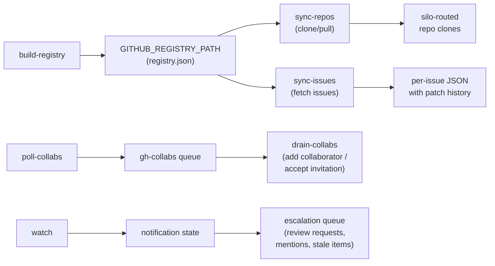

# github/

GitHub repo sync, issue sync, notification monitoring, and collaborator management.

## Scripts

| Script | Description |
| --- | --- |
| `build-registry.ts` | Enumerates all accessible GitHub repos (with push access) and external org repos, builds a JSON registry with metadata and social policy classification |
| `sync-repos.ts` | Shallow-clones or pulls tracked repos in round-robin batches (15 per run) via runner state_items |
| `sync-issues.ts` | Fetches issues for tracked repos in round-robin batches (10 per run), stores as JSON with diff history via fast-json-patch |
| `poll-collabs.ts` | Polls repos and pending invitations, enqueues items needing bot access to the `gh-collabs` queue |
| `drain-collabs.ts` | Dequeues collaborator operations — adds bot as collaborator and accepts invitations |
| `watch.ts` | Polls GitHub notifications for both primary account and bot user, detects important/stale items, enqueues escalations |

## Data Flow

- **build-registry** runs daily, enumerating repos via GitHub API and writing the registry file.
- **sync-repos** and **sync-issues** read the registry and process repos in round-robin order, prioritizing least-recently-synced.
- **sync-repos** keeps each mirror on the repo's current default branch (from the registry): when it changed, the single-branch clone's refspec is switched and the fetch names its destination ref, so `origin/<branch>` always exists. A mirror that still can't be updated is cloned afresh into `repo.fresh` beside it and swapped in, leaving `.meta/` alone. A repo that fails even so is recorded (`lastError`) and the run fails after the batch (#48). Mirrors are reference copies: nothing is committed in them.
- **sync-issues** maintains change history using JSON patches (up to 50 history entries per issue).
- **poll-collabs** / **drain-collabs** manage bot access across repos, switching between primary account and bot user as needed.
- **watch** tracks notification state per user and detects important reasons (review_requested, mention, etc.).

## State and Queues

| Where | What |
| --- | --- |
| `GITHUB_REGISTRY_PATH` (`{CONTENT_DIR}/github/registry.json`) | Repo registry written by `build-registry`; the repos the sync jobs track |
| Runner state items `github` / `repos-sync`, `github` / `issues-sync` | Per-repo round-robin state (least recently synced first) |
| Runner state `github`, key `watch-<user>` | Notification cursor per user |
| Runner state `gh-collabs`, key `poll-state` | `poll-collabs` progress |
| Queue `gh-collabs` | Collaborator additions / invitation acceptances for `drain-collabs` |
| Queue `github-escalations` | Important or stale notifications found by `watch` |

## Prerequisites

- `GH_ACCOUNT` (primary account) and `GH_BOT_USER` (bot) from `integrations.gh.account` / `integrations.gh.botUser` in `jeeves-scripts.json`; both default to empty. The scripts switch between them with `gh auth switch -u <user>`, so `gh` must hold a login for each. After every switch a job checks that `gh api user` reports the login it switched to (case-insensitive, `verifyActingAccount`); a failed switch or any other login fails the run before the next `gh` call, so nothing is read or written as the wrong account (#59). drain-collabs fails the queue item it was on.
- `GH_CONFIG_DIR` (`integrations.gh.configDir`, default `{configDir}/gh-cli`, where `paths.configDir` defaults to `{baseDir}/config`; the `GH_CONFIG_DIR` environment variable wins): every GitHub script sets the `GH_CONFIG_DIR` environment variable to it (`setupGhConfig()`) before calling `gh`, so the logins must live there. The jobs skip (`[skip]`, exit 0) when the directory does not exist; `build-registry` also skips when `GH_ACCOUNT` is empty.
- `GH_BIN` (`gh`, resolved through `PATH`).
- The sync jobs only process repos in the registry, so `github-build-registry` must have run.

All entries in core's manifest `jobs/github.json` carry a non-null `prerequisite` (GitHub CLI auth).

| Job                     | Schedule           |
| ----------------------- | ------------------ |
| `github-build-registry` | Daily at 02:13 UTC |
| `github-sync-repos`     | Every 19 min       |
| `github-sync-issues`    | Every 23 min       |
| `github-watch`          | Every 29 min       |
| `github-poll-collabs`   | Daily at 03:07 UTC |
| `github-drain-collabs`  | Every 31 min       |

## Key Files

| File | Purpose |
| --- | --- |
| `../lib/gh.ts` | GitHub CLI wrappers — `gh()`, `ghJson()`, `ghApi()`, `setupGhConfig()` |
| `../config/silo-router.ts` | `getBasePathForGitHubOrg()` for org-based output routing (see [silos](./config.md#silos) for the `siloRouting` schema) |
| `../lib/constants.ts` | `constants()`: `GH_*` from `integrations.gh` in `jeeves-scripts.json`; `GITHUB_DIR`, `GITHUB_REGISTRY_PATH` under `paths.contentDir` |
