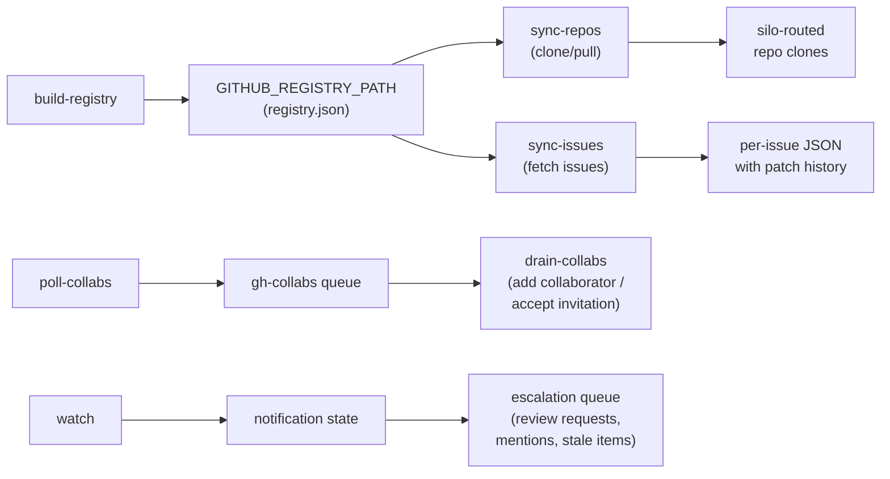

# github/

GitHub repo sync, issue sync, notification monitoring, collaborator management, and cross-repo file and ruleset sync.

## Scripts

| Script | Description |
| --- | --- |
| `build-registry.ts` | Enumerates all accessible GitHub repos (with push access) and external org repos, builds a JSON registry with metadata and social policy classification |
| `sync-repos.ts` | Shallow-clones or pulls tracked repos in round-robin batches (15 per run) via runner state_items |
| `sync-issues.ts` | Fetches issues for tracked repos in round-robin batches (10 per run), stores as JSON with diff history via fast-json-patch |
| `poll-collabs.ts` | Polls repos and pending invitations, enqueues items needing bot access to the `gh-collabs` queue |
| `drain-collabs.ts` | Dequeues collaborator operations — adds bot as collaborator and accepts invitations |
| `watch.ts` | Polls GitHub notifications for both primary account and bot user, detects important/stale items, enqueues escalations |
| `sync-files.ts` | Keeps configured files, and an optional ruleset, identical across the repos of configured owners ([below](#cross-repo-file-and-ruleset-sync)); off until an instance configures and enables it |

## Data Flow



- **build-registry** runs daily, enumerating repos via GitHub API and writing the registry file.
- **sync-repos** and **sync-issues** read the registry and process repos in round-robin order, prioritizing least-recently-synced.
- **sync-repos** keeps each mirror on the repo's current default branch (from the registry): when it changed, the single-branch clone's refspec is switched and the fetch names its destination ref, so `origin/<branch>` always exists. A mirror that still can't be updated is cloned afresh into `repo.fresh` beside it and swapped in, leaving `.meta/` alone; if the swap fails the old mirror stays in place, and any `repo.fresh` or `repo.old` left behind is removed on the next sync. A repo that fails even so is recorded (`lastError`) and the run fails after the batch (#48). Mirrors are reference copies: nothing is committed in them.
- **sync-issues** maintains change history using JSON patches (up to 50 history entries per issue).
- **poll-collabs** / **drain-collabs** manage bot access across repos, switching between primary account and bot user as needed.
- **watch** tracks notification state per user and detects important reasons (review_requested, mention, etc.).
- **sync-files** reads its files from the instance repo and writes them to GitHub through the Contents and Rulesets APIs; it uses no registry and no local clones.

## State and Queues

| Where | What |
| --- | --- |
| `GITHUB_REGISTRY_PATH` (`{CONTENT_DIR}/github/registry.json`) | Repo registry written by `build-registry`; the repos the sync jobs track |
| Runner state items `github` / `repos-sync`, `github` / `issues-sync` | Per-repo round-robin state (least recently synced first) |
| Runner state `github`, key `watch-<user>` | Notification cursor per user |
| Runner state `gh-collabs`, key `poll-state` | `poll-collabs` progress |
| Queue `gh-collabs` | Collaborator additions / invitation acceptances for `drain-collabs` |
| Queue `github-escalations` | Important or stale notifications found by `watch` |
| Runner state `github-sync-files`, key `last-run` | ISO time of the last `sync-files` run with no failure |

## Prerequisites

- `GH_ACCOUNT` (primary account) and `GH_BOT_USER` (bot) from `integrations.gh.account` / `integrations.gh.botUser` in the instance config; both default to empty. The scripts switch between them with `gh auth switch -u <user>`, so `gh` must hold a login for each. After every switch a job checks that `gh api user` reports the login it switched to (case-insensitive, `verifyActingAccount`); a failed switch or any other login fails the run before the next `gh` call, so nothing is read or written as the wrong account (#59). drain-collabs fails the queue item it was on.
- `GH_CONFIG_DIR` (`integrations.gh.configDir`, default `{configDir}/gh-cli`, where `paths.configDir` defaults to `{baseDir}/config`; the `GH_CONFIG_DIR` environment variable wins): every GitHub script sets the `GH_CONFIG_DIR` environment variable to it (`setupGhConfig()`) before calling `gh`, so the logins must live there. The jobs skip (`[skip]`, exit 0) when the directory does not exist; `build-registry` also skips when `GH_ACCOUNT` is empty.
- `GH_BIN` (`gh`, resolved through `PATH`).
- The sync jobs only process repos in the registry, so `github-build-registry` must have run.

All entries in core's manifest `jobs/github.json` carry a non-null `prerequisite` (GitHub CLI auth).

| Job                     | Schedule                            |
| ----------------------- | ----------------------------------- |
| `github-build-registry` | Daily at 02:13 UTC                  |
| `github-sync-repos`     | Every 19 min                        |
| `github-sync-issues`    | Every 23 min                        |
| `github-watch`          | Every 29 min                        |
| `github-poll-collabs`   | Daily at 03:07 UTC                  |
| `github-drain-collabs`  | Every 31 min                        |
| `github-sync-files`     | Daily at 04:30 UTC (ships disabled) |

## Cross-repo file and ruleset sync

`github-sync-files` (`sync-files.ts`) keeps one or more files, and optionally a repository ruleset, identical across every non-archived repo of one or more GitHub owners (users or orgs). It writes straight to each repo's default branch through the Contents API (no clone, no pull request). Its manifest ships `enabled: false`.

### Configuration

Four optional fields on its own job delta, `jobs['github-sync-files']` in the instance config, validated by `config check` (an invalid value fails the check and the run):

```json
{
  "jobs": {
    "github-sync-files": {
      "files": [
        {
          "source": "github/copilot-instructions.md",
          "target": ".github/copilot-instructions.md"
        }
      ],
      "owners": [
        { "owner": "example-bot", "type": "user" },
        {
          "owner": "example-org",
          "type": "org",
          "ruleset": false,
          "exclude": ["example-org/*-archive"]
        }
      ],
      "account": "example-bot",
      "ruleset": {
        "name": "PR Review",
        "target": "branch",
        "enforcement": "active",
        "conditions": {
          "ref_name": { "include": ["~DEFAULT_BRANCH"], "exclude": [] }
        },
        "rules": [
          {
            "type": "copilot_code_review",
            "parameters": { "review_on_push": true }
          }
        ],
        "bypass_actors": []
      }
    }
  }
}
```

| Key | Meaning |
| --- | --- |
| `files[]` | `source`: the content, a path relative to the instance repo root (`paths.scriptsDir`); `target`: the path written in each repo (no leading `/`). Every source is read before any `gh` call; a missing one fails the run. Content is the instance's own and is written as is, byte for byte. |
| `owners[]` | `owner`: the login. `type`: `user` syncs the acting account's own repos (`/user/repos`), so a `user` owner must be `account` (any other is recorded as that owner's failure); `org` syncs `/orgs/<owner>/repos`. `ruleset`: apply the top-level `ruleset` to this owner's repos (default `true`; no effect without one). `include` / `exclude`: glob patterns matched against `full_name` (`owner/repo`, case-insensitive); with `include`, only matching repos are synced; `exclude` leaves matches out. Archived repos are never synced. |
| `account` | The `gh` login that writes. Default `integrations.gh.botUser`; with neither, the run fails. |
| `ruleset` | A ruleset as the Rulesets API takes it: `name`, `target`, `enforcement`, `rules[]` (each with a `type`), other keys passed through. |

With `files` or `owners` unset or empty the run logs `[skip] jobs['github-sync-files'].files/owners is not configured` and exits 0 without calling `gh`.

### Dry run and `--live`

Without `--live` the run logs `[github-sync-files] DRY RUN: pass --live to write`, reads everything, logs each ruleset and file it would create or update, and writes nothing; the summary counts what it would do. Review a dry run (`jeeves-scripts run github-sync-files`), then enable the job with a delta: `"enabled": true, "args": ["--live"]`.

### The acting account

Before switching, the run reads the active login (`gh api user --jq .login`); if it can't, it fails without switching. It then runs `gh auth switch -u <account>` and checks the acting login with `verifyActingAccount` (case-insensitive, as for every GitHub job). On any other login it fails with `github-sync-files: acting gh login is "<got>", expected "<account>"; not writing to any repo`, before listing or writing anything. Whatever happens, it then switches back to the login that was active before the run, not necessarily the bot; a failed switch back fails an otherwise clean run. The account needs the token scopes in the `jeeves-github` skill.

### Each repo

For each owner in order, the run lists its repos (100 a page until a short page) and, for each repo:

1. **Ruleset** (when configured and the owner wants it): `GET /repos/<repo>/rulesets`. A failed call is logged as `rulesets API unavailable`; a ruleset with the configured `name` is left alone; otherwise the ruleset is created (`POST`).
2. **Each file:** `GET /repos/<repo>/contents/<target>?ref=<default branch>`. Identical bytes: skipped. Different or missing: written with `PUT` (with the current `sha` when updating), counted `created` or `updated`. A refusal with HTTP 409 naming a pull request (the branch only accepts changes through a PR) is counted `protected`, not a failure.

A failed listing, a refused ruleset create, a failed write or any error inside one repo is logged and recorded, and the run goes on to the next repo or owner. At the end it logs `[github-sync-files] done: rulesets created=N failed=N files created=N updated=N skipped=N protected=N failed=N`. With no failure it records `last-run` in runner state `github-sync-files`; with any, it fails with one error naming every failure (`github-sync-files: N failure(s); last-run not recorded: ...`) and leaves `last-run` alone. A repeat run with nothing changed writes nothing and records `last-run`.

## Key Files

| File | Purpose |
| --- | --- |
| `../lib/gh.ts` | GitHub CLI wrappers — `gh()`, `ghJson()`, `ghApi()`, `setupGhConfig()` |
| `../config/silo-router.ts` | `getBasePathForGitHubOrg()` for org-based output routing (see [silos](./config.md#silos) for the `siloRouting` schema) |
| `lib/file-sync.ts`, `lib/file-sync-tally.ts` | `sync-files`: repo listing with globs, ruleset create, byte-for-byte file writes; the counts and summary line |
| `../config/github-sync-files-schema.ts` | `githubSyncFileSchema`, `githubSyncOwnerSchema`, `githubRulesetSchema` (the `sync-files` delta fields) |
| `../lib/constants.ts` | `constants()`: `GH_*` from `integrations.gh` in the instance config; `GITHUB_DIR`, `GITHUB_REGISTRY_PATH` under `paths.contentDir` |
