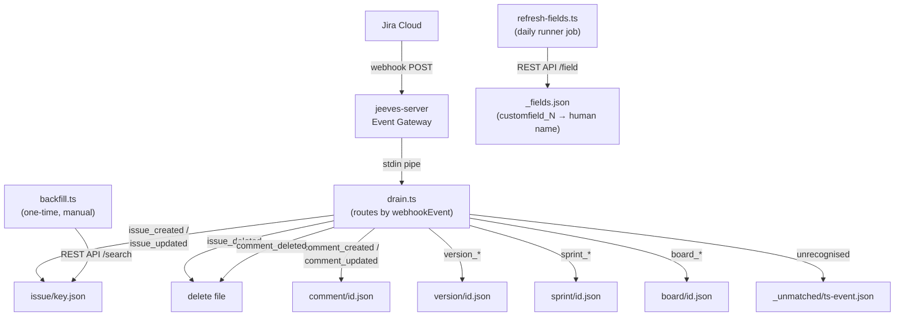

# jira/

Jira Cloud webhook drain, one-time backfill, and custom field metadata refresh.

## Overview

The Jira domain archives Jira Cloud entities — issues, comments, versions, sprints, and boards — as individual JSON files with reverse-diff change history. Two ingestion paths feed the archive:

- **Webhook drain** (`drain.ts`) — real-time stream from Jira's webhook system via the jeeves-server Event Gateway. Each incoming event is routed by `webhookEvent` type and persisted immediately.
- **Backfill** (`backfill.ts`) — one-time historical import via the Jira REST API. Run once when bootstrapping a new instance or after data loss. Existing files are skipped.

Custom field names (e.g. `customfield_10001`) are translated to human-readable aliases (e.g. `Sprint`) using a field metadata cache refreshed daily by `refresh-fields.ts`.

## Architecture



> Domain dir = `getBasePathForJira()/jira/`

## Scripts

| Script | Description |
| --- | --- |
| `drain.ts` | Webhook drain — reads stdin, routes by event type, persists entity snapshots |
| `backfill.ts` | One-time historical import via Jira REST API (`--project KEY [--type issue] [--live]`) |
| `refresh-fields.ts` | Fetch field metadata and write `_fields.json` (daily runner job) |
| `sort-backlog.ts` | Stable-sort the Jira backlog by priority group (`--live` to execute, dry-run by default) |

Supporting modules in `lib/`:

| Module | Description |
| --- | --- |
| `../lib/entity-store.ts` | `upsertEntity`, `backfillEntity`, `deleteEntity`, `writeUnmatched`, `readStdinJson` — shared file I/O with diff history (see [entity-store docs](./lib.md#entity-storets)) |
| `lib/jira-client.ts` | `jiraGet`, `searchIssues` — typed Jira REST API v3 client |

## Archive Structure

```
{CONTENT_DIR}/jira/          ← or silo basePath/jira/ in multi-tenant
  issue/
    ACME-1.json
    ACME-2.json
    ...
  comment/
    12345.json
    ...
  version/
    67890.json
    ...
  sprint/
    1001.json
    ...
  board/
    2001.json
    ...
  _fields.json                ← custom field name map (written by refresh-fields)
  _unmatched/                 ← raw payloads for events not yet routed
    1718800000000-unknown_event.json
```

### Entity Key Extraction

| Entity Type | Payload Object | Key Field | Example File         |
| ----------- | -------------- | --------- | -------------------- |
| `issue`     | `body.issue`   | `key`     | `issue/ACME-1.json`  |
| `comment`   | `body.comment` | `id`      | `comment/12345.json` |
| `version`   | `body.version` | `id`      | `version/67890.json` |
| `sprint`    | `body.sprint`  | `id`      | `sprint/1001.json`   |
| `board`     | `body.board`   | `id`      | `board/2001.json`    |

### Entity File Format

Each entity file is a JSON object with the following structure:

```json
{
  "entityType": "issue",
  "entityKey": "ACME-1",
  "current": { "...": "full Jira payload snapshot" },
  "history": [
    {
      "ts": "2026-01-15T10:00:00.000Z",
      "patch": [
        {
          "op": "replace",
          "path": "/fields/status/name",
          "value": "In Progress"
        }
      ]
    }
  ],
  "meta": {
    "firstSeen": "2026-01-10T08:00:00.000Z",
    "lastWebhook": "2026-01-15T10:00:00.000Z",
    "lastBackfill": null,
    "version": 7
  }
}
```

**Reverse-diff model:** `history` entries are JSON patches that transform the **current** snapshot back to the **previous** state. Apply patches in order from newest to oldest to reconstruct any prior state.

## Webhook Setup

1. In Jira Cloud, go to **Settings → System → WebHooks**.
2. Click **Create a WebHook**.
3. **URL:** `POST https://<instance>/event?key=<event-key>` (jeeves-server's one event endpoint; the gateway routes by matching the body against each event's schema, below).
4. **Events to send:** Select all issue events, comment events, and any additional entity types (version, sprint, board) you want to archive.
5. **JQL filter (optional):** Limit to specific projects, e.g. `project in (ACME, API)`.
6. Save. Jira immediately starts delivering events.

> **Note:** Jira Cloud webhooks deliver events within seconds. There is no replay mechanism — events missed while the gateway is down will not be redelivered. Run the backfill script after any extended downtime.

## Event Gateway Config

Add this block to your jeeves-server Event Gateway configuration:

```jsonc
{
  "events": {
    "jira": {
      "schema": {
        "type": "object",
        "required": ["webhookEvent"],
        "properties": {
          "webhookEvent": { "type": "string" },
        },
      },
      "cmd": "node $JEEVES_SCRIPTS_DIR/bin/jeeves-scripts.js run jira-drain",
      "timeoutMs": 10000,
    },
  },
}
```

- `$JEEVES_SCRIPTS_DIR` - absolute path to the instance repo (`paths().scriptsDir`)
- `jira-drain`: a core runnable with no manifest (event-driven: the event gateway runs `run jira-drain`)
- `schema` - JSON Schema validated against the POST body (ajv, first match wins across all configured events); `webhookEvent` tells Jira's payloads apart from Linear's (`action` + `type`)
- `cmd` - the server spawns this command and pipes the request body JSON to stdin
- `timeoutMs` - kill timeout for the drain process (falls back to global `eventTimeoutMs`); 10 seconds is ample for this I/O-only drain

> **Webhook URL:** `POST https://<instance>/event?key=<event-key>` - the same endpoint the Linear drain uses.

The gateway pipes the raw HTTP request body to the script's stdin and captures stdout/stderr for logging.

## Custom Field Translation

Jira stores custom fields as `customfield_N` keys. The drain script enriches issue payloads with human-readable aliases using a field map stored in `_fields.json`:

```json
{
  "customfield_10001": "Sprint",
  "customfield_10014": "Epic Link",
  "customfield_10020": "Story point estimate"
}
```

The map is updated daily by `refresh-fields.ts` (scheduled runner job). After an alias is added to `_fields.json`, all new webhook events will include both the raw key and the alias:

```json
{
  "customfield_10001": { "id": "42", "name": "Sprint 7" },
  "Sprint": { "id": "42", "name": "Sprint 7" }
}
```

## Backfill

Run the backfill once after setting up the webhook to populate historical data: run the core runnable `jira-backfill` (no manifest needed):

```bash
# Dry run (preview — no writes)
node bin/jeeves-scripts.js run jira-backfill --project ACME

# Live run (actual writes)
node bin/jeeves-scripts.js run jira-backfill --project ACME --live

# Backfill a different entity type (future)
node bin/jeeves-scripts.js run jira-backfill --project ACME --type issue --live
```

**CLI arguments:**

| Argument        | Default      | Description                                |
| --------------- | ------------ | ------------------------------------------ |
| `--project KEY` | _(required)_ | Jira project key (e.g. `ACME`)             |
| `--type TYPE`   | `issue`      | Entity type to backfill                    |
| `--live`        | false        | Perform actual writes (dry-run by default) |

**Rate limiting:** 200 ms pause between API requests to avoid hitting Jira Cloud rate limits.

**Skip behaviour:** The backfill skips any entity file that already exists on disk. This ensures webhook-delivered data (which is fresher) is never overwritten by the backfill.

## Editing and restructuring tickets

For an assistant changing tickets through the REST API (#47). Work from the live ticket: the archive lags.

### Edit part of an ADF description

1. Back up `.fields.description` (an ADF doc; its nodes are under `.content`).
2. Map the nodes: `jq -c '.content | to_entries[] | {i:.key, type:.value.type, t:([.value|..|.text?]|map(select(.!=null))|join(" | ")|.[0:200])}'`. For lists and tables, map their children too.
3. Make the smallest splice that does the job:
   - a whole section: `jq --slurpfile n new.json '.content = (.content[0:<s>] + $n[0] + .content[<e>:])'`;
   - one bullet: set `.content[i].content[j].content[0].content`;
   - table rows: `tableRow` > `tableCell` > `paragraph`.

   Add a line in italics saying who asked for the change and when.
4. Map the result again and diff it against the backup. Restore any node changed by mistake from the backup.
5. PUT `{fields:{description:...}}` (expect 204). Re-GET and confirm the old values are gone and the new ones are present.
6. Bring any spec or handoff docs that repeat the rule into line, backing each up first. Ask about other stale copies, such as closed sibling tickets or test cases someone else owns; don't edit them.

REST v2 accepts plain wiki markup as `description`, which is simpler than ADF for a full rewrite.

### Restructure tickets

Merging, rescoping, closing as duplicate or superseded, fixing link direction:

- **Map the current links with their ids:** `jq -r '.fields.issuelinks[]|"\(.id) \(.type.name) \(.inwardIssue.key // "SELF") -> \(.outwardIssue.key // "SELF")"'`. An `if … end` inside a jq string interpolation must be wrapped in parentheses, or jq fails to compile.
- **Link direction** for `POST /rest/api/3/issueLink`: `{type:{name:"Blocks"},inwardIssue:{key:A},outwardIssue:{key:B}}` means _A blocks B_; the same shape with `Duplicates` means _A duplicates B_. If unsure, GET an existing link and compare it with how the ticket displays it. The `jeeves-jira` skill's Links section has the full check.
- **Merging tickets into one PR:** replace every `Blocks` link between the group's members with `Relates`, checking each member's links, not just the anchor ticket's.
- **Closing a duplicate:** add a `Duplicates` link to the ticket that stays, then close with resolution `Duplicate`.
- **Closing a superseded ticket:** add `Relates` links to its replacements, then close with resolution `Won't Do`.
- **Transitions:** check `GET /rest/api/3/issue/<K>/transitions?expand=transitions.fields`; a Closed transition can require `fields.resolution` in the same POST.
- **Ask before removing links** from closed tickets that weren't part of the request.
- **One dry-run script:** put every operation in one script whose API helper only prints unless `--live` is passed. Run it dry, compare the list with what was agreed, run it `--live` (exit on any non-2xx), then re-GET every ticket it touched.
- **The user decides** how tickets get merged: propose groupings, and apply only the ones they accept.

## Prerequisites

| Prerequisite | Where to configure |
| --- | --- |
| Jira Cloud account with API token | [id.atlassian.com → API tokens](https://id.atlassian.com/manage-profile/security/api-tokens) |
| `JIRA_SITE_URL` | `integrations.jira.siteUrl` — e.g. `'https://mysite.atlassian.net'` |
| `JIRA_EMAIL` | `integrations.jira.email` — Atlassian account email |
| `JIRA_API_TOKEN_PATH` | `integrations.jira.apiTokenPath` — path to API token file |
| Jira webhook configured to POST to jeeves-server | Jira Cloud → Settings → System → WebHooks |
| jeeves-server event gateway configured with a `jira` event | `jeeves-server` config `events.jira` (see Event Gateway Config above) |
| Board id for `jira-sort-backlog` | `integrations.jira.boardId` (numeric Jira Agile board id); the `JIRA_BOARD_ID` environment variable wins when set (Decision 53) |

## Key Files

| File | Purpose |
| --- | --- |
| `drain.ts` | Webhook drain entry point — stdin pipe from Event Gateway |
| `backfill.ts` | One-time historical backfill via REST API |
| `refresh-fields.ts` | Daily custom field metadata refresh |
| `sort-backlog.ts` | Backlog priority sort — stable re-rank by priority group via Agile API |
| `../lib/entity-store.ts` | Shared file I/O helpers with reverse-diff history — `upsertEntity`, `backfillEntity`, `deleteEntity`, `writeUnmatched`, `readStdinJson` (see [entity-store docs](./lib.md#entity-storets)) |
| `lib/jira-client.ts` | Typed Jira REST API v3 client (fetch, paginate) |
| core `jobs/jira.json` | Runner job manifests (refresh-fields and sort-backlog schedules) |
| `../lib/constants.ts` | `constants()`: `JIRA_SITE_URL`, `JIRA_EMAIL`, ... from `integrations.jira` in `jeeves-scripts.json` |
