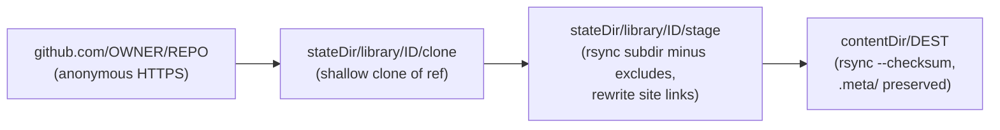

# library/

Reference libraries: subdirectories of public GitHub repos mirrored into the content tree, where the watcher indexes them and meta synthesizes them.

A third-party skill or playbook library is often too large to install as agent skills (the skills prompt has a fixed budget). Mirrored into the content tree, it costs nothing per turn: the assistant searches it and reads the file it needs.

## Scripts

| Script | Description |
| --- | --- |
| `sync-mirrors.ts` | Runnable `library-sync-mirrors`: mirrors every configured `library.mirrors` entry into the content tree ([below](#library-mirrors)). Off until an instance configures and enables it. Dry run unless `--live`. |

## Library mirrors



For each mirror, in config order:

1. **Clone.** Shallow-clones `https://github.com/<repo>.git` at `ref` into `{stateDir}/library/<id>/clone`, or fetches `ref` into the existing clone and hard-resets to it. No credentials: the repo must be public. Checkouts never convert line endings (`core.autocrlf=false`, `core.eol=lf`, whatever the host's git config says), so the mirror holds the repo's bytes on every platform. A clone that can't be updated is deleted and cloned again: it is a cache.
2. **Stage.** `rsync --recursive --links --safe-links --times --checksum --delete --delete-excluded` copies the clone's `subdir` (or the whole clone) into `{stateDir}/library/<id>/stage`, leaving out `exclude[]` and always `.git/`. `--delete-excluded` makes an `exclude` added later remove what earlier runs staged, and so (through the publish step's `--delete`) what they published. The repo is untrusted, so symlinks are copied only when they stay inside the tree (`--safe-links`, in both rsync passes): an absolute link, or one that climbs out of the tree, is never copied into the content tree. A `subdir` that resolves (symlinks followed) outside the clone fails the mirror before staging.
3. **Rewrite links** (only when `siteLinks` is set). In every staged UTF-8 text file (code and data files included, not only Markdown, as spec 2.9 step 4 says; files with a NUL byte or that aren't valid UTF-8 are left alone), each Markdown link whose target matches `pattern` (with an optional trailing `/` and `#anchor`; the pattern matches case-insensitively, as the prototype's did, so `/Skill/x` matches `/skill/{name}`, while the name is then looked up exactly) is pointed at the matching `target` file by a relative path. With `"pattern": "/skill/{name}"` and `"target": "{dir}/SKILL.md"`, a link to `/skill/cold-email` in `author-a/reporting/SKILL.md` becomes a link to `../cold-email/SKILL.md` when `author-a/cold-email/SKILL.md` exists. `{name}` is the last segment of `{dir}`; a target under the same top-level directory as the linking file wins; a name with no target, or with several and none of them under the same top-level directory, is left unchanged. A rewritten file keeps its original mtime, so a day with no upstream change writes nothing. Nothing else in a mirrored file is ever changed (no redaction: a reference copy stays exact).
4. **Guards.** The run fails for this mirror, before the destination is touched, when the source is missing or resolves outside the clone, the staged tree is empty, the state dir and the destination are on different filesystems (renames would not be atomic), the destination exists holding content this mirror didn't write and `adopt` is not set (see [the publish record](#the-publish-record)), or the staged file count is below `minRatio` of the files now mirrored (`.meta/` not counted; skipped while the destination does not exist).
5. **Publish.** First run (destination absent): the tree is assembled in `{stateDir}/library/<id>/incoming` (cleared first, in case a failed run left one) and renamed into `{contentDir}/<dest>` in one step, instead of streaming every file into the watched tree. Later runs: `rsync --checksum --delete --temp-dir={stateDir}/library/<id>/tmp` (excluding `.meta/`, with no `--delete-excluded`, so meta output stays) writes only the changed files, each renamed into place, so the watcher never sees a partial file and an unchanged day raises no watcher events. A successful live publish (either kind) writes the mirror's [publish record](#the-publish-record).
6. **Report.** Progress lines are prefixed `[library-sync-mirrors]`. One line per mirror (`<id>: live|dry-run head=<sha> files=<n> links=<n> write=<n> touch=<n> delete=<n>`, plus `created` when it created the destination), then one `JR_RESULT` line: `meta` (the per-mirror lines, for the runner's run history), `mirrors` (`id`, `head`, `files`, `links`, `write`, `touch`, `delete`, `created` per mirror) and `failed` (the error by mirror id).

- **Dry run** (no `--live`): the clone and the stage are updated (they live in the state dir); the destination, `incoming` and `tmp` are never written, and the report says what a live run would do (`WOULD CREATE` on a first run, compared against the absent destination, so a stale `incoming` never skews the counts; `WOULD ADOPT` for an existing destination taken over with `adopt: true`). A destination a live run would refuse fails the dry run's mirror too, with `would refuse: <dest> exists and was not written by this mirror (set adopt: true)`; the publish record is never written.
- **`.meta/` is never touched.** Meta synthesis output inside the destination, at any depth, is neither modified nor deleted.
- **Failures.** One mirror's failure (a guard, or a `git` or `rsync` error) never stops the others; after the last mirror the run fails, naming every failed mirror, so the runner's failure alert fires.
- **Idempotent.** A re-run with no upstream change writes, touches and deletes nothing.

### The publish record

Each successful live publish writes `{stateDir}/library/<id>/published.json`: `dest` (the absolute destination, `paths.contentDir` joined with the mirror's `dest`), `head` (the short head SHA published) and `publishedAt` (ISO 8601). It sits in the state dir, so the watcher never sees it. Before a run writes to an existing destination it checks the record, so a typo or a reused `dest` (pointing at `github`, `slack` or hand-written notes) is never wiped by `--delete`:

- **Destination absent:** first-run publish by one rename, as above.
- **Destination exists and the record names it:** a normal sync.
- **Destination exists holding nothing but `.meta/` (or nothing at all):** published without opt-in; there is nothing the mirror would take over.
- **Destination exists with anything else and no record for it:** the mirror is refused (`refusing to publish: <dest> exists and was not written by this mirror; set adopt: true on the mirror to take it over`), unless the mirror sets `adopt: true`. A refused mirror fails the run like any other mirror failure; the other mirrors still run.

A record for a different destination does not count: change a mirror's `dest` to an existing directory and that directory is refused like any other. A record that isn't valid JSON of this shape fails the mirror until it is fixed or deleted. The shrink guard (`minRatio`) still applies to an adopted destination.

#### Adopting an existing mirror

To let a mirror take over a destination it didn't write (one an earlier tool or script maintained, for example):

1. Set `"adopt": true` on the mirror.
2. Run a dry run (`jeeves-scripts run library-sync-mirrors`) and review it: `WOULD ADOPT <dest>`, then the files it would write and delete. Everything in the destination that the repo doesn't have, apart from `.meta/`, will be deleted.
3. Run it live (`--live`, or let the scheduled job run). The publish is recorded.

Once a publish is recorded the flag has no further effect and can be removed.

- Bundled scripts in a mirrored repo are copied as files for reference; nothing here runs them.

### Configuration

The top-level `library` block (`librarySchema`, [config](./config.md)):

```json
"library": {
  "mirrors": [
    {
      "id": "skills",
      "repo": "acme/skills-library",
      "ref": "main",
      "subdir": "skills",
      "dest": "library/skills",
      "exclude": [".system/"],
      "siteLinks": { "pattern": "/skill/{name}", "target": "{dir}/SKILL.md" }
    }
  ]
}
```

| Key | Default | Rules |
| --- | --- | --- |
| `id` | required | Lowercase slug (`a-z`, `0-9`, dashes), unique across `mirrors`. Names the state dir and the log lines. |
| `repo` | required | `owner/repo` of a public GitHub repo. |
| `ref` | `main` | Branch or tag; not starting with `-`. |
| `subdir` | `''` (whole repo) | Relative, no `..` segment. |
| `dest` | required | Relative to `paths.contentDir`, no `..` segment, not the content dir itself, not under `.meta` (in any case: `.Meta` is refused too, as case-insensitive filesystems would put it there), and not equal to, inside or around another mirror's `dest` (its `--delete` would remove the other's files). |
| `exclude` | `[]` | rsync filter patterns, source-relative (`.system/`, `/drafts/`, `*.pyc`). `.git/` is always excluded. Adding a pattern later removes the matching files from the mirror on the next run. |
| `minRatio` | `0.5` | `0 < minRatio <= 1`. |
| `siteLinks` | unset (no rewriting) | `pattern` with exactly one `{name}` (and no `{dir}`); `target` with exactly one `{dir}` (and no `{name}`). A fixed template, never a regex. |
| `adopt` | `false` | Take over an existing `dest` this mirror did not write on the next live run ([adopting](#adopting-an-existing-mirror)); once a publish is recorded the flag has no further effect and can be removed. |

With `library.mirrors` empty or absent the runnable logs `[skip] no library.mirrors configured` and exits 0. An invalid block fails `config check` and every run (Decision 76).

To turn it on: add the block, run `jeeves-scripts run library-sync-mirrors` and check the dry run, then enable the job with a delta that adds `--live`:

```json
"jobs": {
  "library-sync-mirrors": { "enabled": true, "args": ["--live"] }
}
```

### Watcher and meta

Index the mirrors with a watcher inference rule, for example:

```json
"library/**": { "domain": "library", "source": "<mirror id>" }
```

(one rule per mirror when each needs its own `source`, e.g. `"library/skills/**": { "domain": "library", "source": "skills" }`), and seed a meta at each mirror's destination so meta synthesizes it.

## Prerequisites

- No credentials: each repo is public and cloned anonymously over HTTPS; `integrations.gh` is not used.
- `git` and `rsync` on `PATH`. With mirrors configured, a run checks both (`git --version`, `rsync --version`) before any mirror runs: when either is missing the run fails (`rsync not found on PATH: library-sync-mirrors needs git and rsync to run library.mirrors (install rsync: Linux: apt install rsync; Windows: choco install rsync)`, exit 1), so the runner's failure alert fires on a host that lost a tool or was built without it. `doctor` reports the same message as the prerequisite not met (the runnable's `doctorCheck`, [runnables](./runnables.md#declaring-a-runnable)). With no mirrors configured the run still skips with exit 0, whatever is on `PATH`. The manifest's `prerequisite` stays `null`, so deploy registers the job (disabled).
  - Linux: install `rsync` from the distribution (`apt install rsync`).
  - Windows: `choco install rsync` (cwRsync, a Cygwin build). It reads a path like `C:\x` as a remote host, so the runnable passes every path to it as `/cygdrive/c/x`. Cygwin also gives the files it creates POSIX-style ACLs instead of the destination's inherited ones (readable by the owner, `SYSTEM` and Administrators). To have mirrored files inherit the content tree's ACLs, create `etc\fstab` in the package's `tools` directory (`C:\ProgramData\chocolatey\lib\rsync\tools\etc\fstab`) holding `none /cygdrive cygdrive binary,noacl,posix=0,user 0 0`; keep the `/cygdrive` prefix. A package upgrade may remove the file.
- `paths.stateDir` and `paths.contentDir` on the same filesystem.

| Job                    | Schedule           |
| ---------------------- | ------------------ |
| `library-sync-mirrors` | Daily at 04:10 UTC |

## Key Files

| File | Purpose |
| --- | --- |
| `sync-mirrors.ts` | The runnable: prerequisite, tool check, `--live`, config and paths |
| `lib/sync-mirror.ts` | One mirror end to end, and the loop over every mirror |
| `lib/clone.ts` | The working clone (clone, update, re-clone) |
| `lib/mirror.ts` | `mirrorTree`: guards, then publish the stage (first-run rename or rsync) |
| `lib/stage.ts` | Staging: rsync the source into the stage, rewrite site links; `listFiles` |
| `lib/publish-record.ts` | The publish record and the existing-destination ownership check |
| `lib/library-links.ts` | Site-link template matching and rewriting |
| `lib/rsync.ts` | rsync arguments (with Windows path conversion) and `--itemize-changes` counts |
| `../config/library-schema.ts` | The `library` block schema |
| core `jobs/library.json` | The runner job manifest (shipped disabled) |
