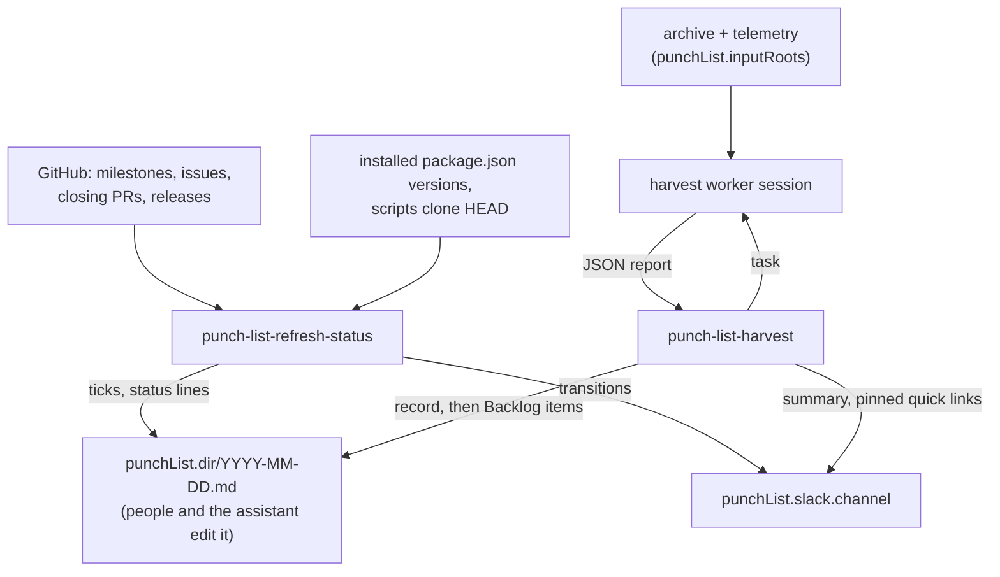

# punch-list/

A per-instance running list of platform work, kept by the assistant: tasks, a backlog of requested and inferred work, and milestones followed through GitHub to release and install.

## Overview

The punch list is one Markdown file per day in `punchList.dir`. People and the assistant edit it directly; two runnables keep it current:

- **`punch-list-refresh-status`** (every 61 minutes once enabled) applies checkbox ticks, follows each milestone's GitHub issues to release and install, writes today's file and posts milestone transitions to Slack.
- **`punch-list-harvest`** (daily once enabled) finds platform work in the instance's own archive (email, Slack, meetings, Drive) and telemetry (runner, watcher, meta) through one worker session, and files it to the Backlog without anyone asking.

Both ship disabled and skip with `[skip] no punchList block in the instance config` (exit 0) until the instance configures the `punchList` block. Both are dry runs unless `--live`.

| Script | Description |
| --- | --- |
| `status/job.ts` | Runnable `punch-list-refresh-status`. Without `--live` it computes and logs today's file and the post, and writes and posts nothing. |
| `harvest/job.ts` | Runnable `punch-list-harvest`. `--print-task` prints the worker's task and where it came from, and dispatches nothing; without `--live` it dispatches the worker but writes and posts nothing. |

## Architecture



Every write to the file holds a cross-process lock (`lockFile`) and goes through a temp file and a rename. If the file changed since it was read (a person or the assistant editing at the same time) the write re-reads and retries, up to three attempts. A file that doesn't parse fails the run and is never overwritten.

## The daily file

`{dir}/YYYY-MM-DD.md`, "today" being the date in `punchList.timeZone`. The first run of a day rolls the latest earlier file over: unfinished work carries forward, and finished entries older than `retentionDays` are left off (archiving is omission; the earlier files stay as they are).

```markdown
# Punch List — 2026-10-18

## Tasks

- [ ] **Rotate the expiring token** — the token expires Friday · added 2026-10-18 · `t-0a1b2c3d`

## Backlog

- [ ] **Dropbox support** — files live there · requested by Ana · [thread](https://…) · added 2026-10-17 · `b-0e1f2a3b`

## TODO

### acme-dropbox — Dropbox support

Free prose: the plan, the integration steps.

- Issues: [acme/jeeves-scripts-acme#2](https://github.com/…) open

## Done

_None._

## Integrated

_None._

## Completed Tasks

_None._

## Processed Backlog Items

_None._
```

| Section | Holds | Moves |
| --- | --- | --- |
| Tasks | Checkbox entries (`t-` ids): platform work to do. | Ticked: to Completed Tasks, stamped `done <date>`. |
| Backlog | Checkbox entries (`b-` ids): requested or inferred work not yet planned. | Ticked: to Processed Backlog Items, stamped `processed <date>` (promoted to a milestone, done or rejected). |
| TODO | Milestone blocks being worked. | All issues shipped: to Done. |
| Done | Milestones whose issues all shipped, with `- [ ] Integrated`. | `Integrated` ticked: to Integrated, stamped with the date. A reopened or unreleased issue: back to TODO. |
| Integrated | Finished milestones, `- [x] Integrated <date>`. | Unticked: back to Done for another look. |
| Completed Tasks, Processed Backlog Items | Finished entries. | Unticked: back to Tasks or Backlog. |

- **Entries**: `- [ ] **Title** — details · <markers> · \`t-0a1b2c3d\``. The text between the checkbox and the id is kept verbatim. A person may type an entry without an id; the next write gives it one. Markers (`added`, `done`, `processed`, each with a date) are separated by ` · `.
- **Milestones**: `### <slug> — Title`, free prose, then the checker's status lines (`- Issues: `, `- Releases: `, `- Installed: `), which it rewrites each run. A milestone's slug is the title of the GitHub milestone holding its issues, in the scripts repo or any install-map repo. Convention: prefix the instance's name (`acme-dropbox`); core treats the slug as an opaque string and enforces no form.
- An empty section holds `_None._`.

`parsePunchList` and `renderPunchList` (root exports) read and write this format; `parsePunchList(renderPunchList(x))` equals `x`.

## punch-list-refresh-status

1. Skips without a `punchList` block. Resolves today in `timeZone` and loads (or rolls over) today's file.
2. Collects every TODO and Done milestone, and every Integrated milestone sent back (`Integrated` unticked).
3. For each, reads the GitHub milestone of that title in the scripts repo and every `installMap` repo (`gh`, the instance's gh auth): its issues, each issue's closing PRs (GraphQL), and each repo's published releases (no drafts or prereleases). Lists are read 100 at a time with no further pages.
4. **Done** when every issue shipped (in a release, or as a merged PR in the scripts repo, which is unversioned) or was closed as not planned, and at least one shipped; otherwise TODO. A Done milestone with an issue no longer shipped moves back to TODO.
5. **Installed** (Done milestones): a release tag `component/version` (or a bare `version`, component `''`) is installed when a `package.json` matching that component's `installMap` glob holds the same major.minor.patch or later; a scripts-repo PR is installed once its merge commit is an ancestor of `scriptsRepo.clone`'s `HEAD` (`git merge-base --is-ancestor`).
6. Applies the checkbox ticks (table above), writes the file under the lock, and logs one line: `<day>: N milestone(s) checked; [ticks applied; ]file written|would change|unchanged`.
7. Posts one message per run when a milestone newly reached Done, became fully installed or reopened, to `slack.channel` with `slack.account`'s bot token, linking today's file through jeeves-server. A post that fails is kept in `pendingFile` and retried, oldest first, before anything new on the next run.

Without `--live` it logs the file it would write and `[dry-run] would post to <channel>:` with the message. A run against unchanged GitHub state and an already-ticked file writes nothing and posts nothing.

## punch-list-harvest

1. Skips without a `punchList` block. Rolls today's file over if needed.
2. `--print-task`: logs where the task came from and the task (with the saved window, or the last 24 hours on a first run), then stops: no dispatch, no writes.
3. Finishes any undelivered harvest record (`{dir}/harvest/*.json` with `delivered: false`) left by an earlier run, oldest first, without dispatching again: merges its items, posts and marks it delivered.
4. **Window**: from the saved cursor (`cursorFile`); on the first run, from 24 hours before the run, saved at once so a failed first run retries the same window.
5. **Pre-check**: if nothing under `inputRoots` (each expanded for `{npmGlobal}` and `{home}`) changed since the window start, logs `no new input since <time>; nothing dispatched` and stops.
6. **Task**: the standing orders from `{dir}/TASK.md` when the instance has one, else core's template (`task-templates/punch-list/harvest.task.md`, read from the package; nothing is copied). The run logs which (`task from the instance file …` or `task from core template punch-list/harvest.task.md (no instance file at …)`). Then the run's section: the window, the input paths, the spec (when `specPath` is set), everything already on the list (so the worker proposes no duplicate), and the output contract, stamped with today's date in `timeZone`.
7. **Worker**: one session through jeeves-runner's `dispatchSession` with low thinking. It writes one JSON report to the file the task names (in `inboxDir`) and replies `DONE`; nothing reads its session history.
8. **Report** (validated before anything is written): `{"items":[{"title","why","kind","requester","sources"}],"summary"}`. `title` 3-120 characters; `why` up to 600; `kind` `requested` (with `requester`) or `inferred`; at least one source, each an absolute file path from a watcher hit or a telemetry reference (`runner:<job>#<run>`, `watcher:<path>`, `meta:<path>`). A report of `HARVEST_FAILED: <reason>` (a worker whose tools failed) fails the run with the cursor unmoved, so the window is retried.
9. **Merge**: an item whose title is already on the list (any section or milestone, case-insensitive) is skipped, as is one with no source left once each file source is turned into a jeeves-server link (a file outside the server's roots, or missing, is dropped). Telemetry references stay as code. Each skip is logged (`skipped "<title>": <reason>`).
10. **Record first**: the planned items are saved to `{dir}/harvest/<run start>.json` before the file is touched; then the items join the Backlog (`requested by <name>` or `inferred`, the sources, `added <date>`), the summary is posted and the record marked delivered. A crash anywhere after the record resumes at step 3.
11. **Pinned quick links**: with `slack.pinnedTs` set, edits that message to link today's file and the spec (the spec line is left out without `specPath`); without it, logs `no pinned message ts configured; quick links not updated`.
12. Advances the cursor to the run's start, only on a successful live run.

Without `--live` the worker is still dispatched (the report is real) but no file, record or cursor is written, the pinned message is left alone and nothing is posted: the worker writes its report to a temporary directory that the run removes (even when the run fails), not to `inboxDir`, which a dry run never creates. Re-running with no new input and no undelivered record does nothing.

The file is an authored record, not a mirror: harvested items are the worker's paraphrase with attribution and links. Nothing here redacts; the watcher redacts secrets at index time (Decision 70).

### The harvest task

Core's template tells the worker which tools it may use (watcher search and scan, reading files it found, runner, watcher and meta status; no session, memory, web, `exec` or messaging tools), a budget of 30 tool calls, what to look at, and what to report: platform work only (the instance, its integrations, jobs and assistant, not the business's own work), requested items with the requester named, inferred items with why they matter, one item per need, every item citing a source, and `HARVEST_FAILED` when a tool fails. An instance with different needs writes its own `{dir}/TASK.md`; the run section and output contract are always appended by the runnable.

## Configuration

The top-level `punchList` block (`punchListSchema`, [config](./config.md)). Absent: both runnables skip. Present but invalid: `config check` and every run fail (Decision 76).

```json
"punchList": {
  "dir": "/base/content/admin/punch-list",
  "timeZone": "America/Chicago",
  "slack": { "channel": "C0123456789" },
  "specPath": "/base/content/admin/punch-list-spec.md",
  "scriptsRepo": { "repo": "acme/jeeves-scripts-acme", "clone": "/base/jeeves-scripts" },
  "installMap": {
    "karmaniverous/jeeves-server": [
      { "component": "service", "packageJson": "{npmGlobal}/@karmaniverous/jeeves-server/package.json" }
    ]
  }
}
```

| Key | Default | Rules |
| --- | --- | --- |
| `dir` | required | Absolute path. The daily files, `harvest/` records and an optional `TASK.md`. |
| `timeZone` | required | IANA zone. Sets the day boundaries, not when the runner fires a job. |
| `retentionDays` | `30` | Positive integer. |
| `slack.channel` | required | A channel or user id (`C…`, `G…`, `D…`, `U…`, `W…`), or a `channel:` / `user:` target. Channel names are refused, as everywhere in core. |
| `slack.account` | `default` | The gateway Slack account whose bot token posts. |
| `slack.pinnedTs` | unset | `ts` of the pinned quick-links message; unset, the harvester leaves it alone. |
| `specPath` | unset | Absolute path of the instance's punch-list spec, linked from the pinned message and the harvest task. |
| `scriptsRepo.repo` | required | `owner/name` of this instance's scripts repo (unversioned: Done means a merged PR). |
| `scriptsRepo.clone` | required | Absolute path of its deployed clone. |
| `installMap` | `{}` | `owner/name` → `[{ component, packageJson }]`: the versioned repos scanned for milestones, and the glob of each released component's installed `package.json`. `{npmGlobal}` expands to npm's global `node_modules` (`<prefix>/lib/node_modules`, `<prefix>\node_modules` on Windows), with the prefix from `npm_config_prefix` when set, else `npm prefix -g` (read once per run; it honours every npmrc, e.g. the standard Windows installer's `%APPDATA%\npm`), else npm's built-in default when npm can't be run; `{home}` expands to the home directory. Core ships no map. |
| `lockFile` | `{stateDir}/punch-list/punch-list.lock` | Absolute path. |
| `pendingFile` | `{stateDir}/punch-list/status-pending.json` | Absolute path. |
| `cursorFile` | `{stateDir}/punch-list/harvest-cursor.json` | Absolute path. |
| `inboxDir` | `{stateDir}/punch-list/inbox` | Absolute path. |
| `inputRoots` | the default silo's `email`, `slack`, `meetings`, `google-drive`, and `{stateDir}/jeeves-watcher/issues.json` | Non-empty list of absolute paths, or paths starting with `{home}` or `{npmGlobal}` (expanded as for `installMap` when the config is resolved, so `config check`, the pre-check and the worker's task all agree); set it for a multi-silo instance. |

The jeeves-server config is read from `{configDir}/jeeves-server/config.json` (its `publicUrl` and `roots`), like every component config.

To turn it on: add the block, run each runnable without `--live` (and `punch-list-harvest --print-task`) and check the output, then enable the jobs with deltas that add `--live` (the manifests pass no arguments, so a job enabled without it is a scheduled dry run); set the harvest's schedule and zone in its delta if 05:47 UTC doesn't suit:

```json
"jobs": {
  "punch-list-refresh-status": { "enabled": true, "args": ["--live"] },
  "punch-list-harvest": {
    "enabled": true,
    "args": ["--live"],
    "schedule": { "freq": "daily", "byhour": 5, "byminute": 47, "timezone": "America/Chicago" }
  }
}
```

The `punch-list` skill tells every session how to read and add to the file.

## Prerequisites

- `gh` authenticated for every scanned repo (`integrations.gh`).
- A gateway Slack account with a bot token that may post to `slack.channel` (and edit the pinned message).
- jeeves-server, with `punchList.dir` and the archive under its roots (links to the file and to sources).
- jeeves-runner and the gateway, for the harvest worker.
- `git` on `PATH` (the scripts-repo install check).

| Job                         | Schedule                                 |
| --------------------------- | ---------------------------------------- |
| `punch-list-refresh-status` | Every 61 minutes (UTC), shipped disabled |
| `punch-list-harvest`        | Daily at 05:47 UTC, shipped disabled     |

## Key Files

| File | Purpose |
| --- | --- |
| `config.ts` | The resolved `punchList` block (derived paths, bare channel id), `scannedRepos`, `expandPath` |
| `runtime.ts` | The skip, shared run dependencies and today's file |
| `store.ts`, `lock.ts` | Load, roll over and write the daily file under the lock |
| `model/` | The file model: types, line grammar, parse, render, transitions |
| `github/` | The GitHub port, facts per milestone, install checks |
| `status/` | `punch-list-refresh-status`: refresh, pending posts, the run |
| `harvest/` | `punch-list-harvest`: input pre-check, task, worker, report, record, merge, the run |
| `messages.ts`, `slack.ts`, `links.ts` | Slack messages, posting, jeeves-server links |
| `../config/punch-list-schema.ts` | The `punchList` block schema |
| core `task-templates/punch-list/harvest.task.md` | The bundled harvest task |
| core `jobs/punch-list.json` | The runner job manifests (shipped disabled) |
