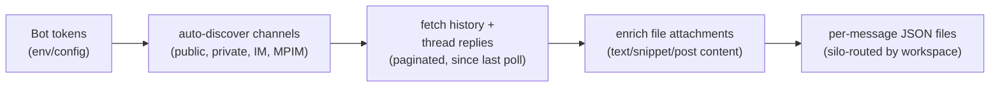

# slack/

Polls Slack channels for new messages across configured workspaces, auto-discovers channels the bot has joined, and writes per-message JSON archives. Keeps channel descriptions, topics and home directories in step with the corpus ([Channel Meta](#channel-meta)).

## Scripts

| Script | Description |
| --- | --- |
| `poll.ts` | Auto-discovers channels, fetches history and thread replies via Slack API, writes individual JSON files per message to silo-routed directories. Supports multi-account/multi-workspace scenarios. |
| `backfill-history.ts` | `slack-backfill-history`, on demand: re-reads one channel from its first message up to a bound without moving `slack-poll`'s read position. See [Re-reading History](#re-reading-history). |
| `refresh-channel-meta.ts` | `slack-refresh-channel-meta`, daily, shipped disabled: proposes home directories from channel posts, refreshes descriptions and topics from each channel's meta through one worker, writes a dated report and posts a summary. See [Channel Meta](#channel-meta). |

## Data Flow



- Loads Slack bot tokens (see [Bot Tokens](#bot-tokens)).
- Discovers all channel types the bot is a member of (public, private, IM, MPIM), excluding archived, for every token's account (IMs always count). Each run refreshes known channels' name and flags from Slack and adds new ones with `_autoDiscovered` (timestamp) and `_account` (the token's account name), in the [Slack cache](#slack-cache-state).
- Reads conversation history since the last read position per channel, oldest first, one page (200 messages) at a time: given `oldest` and no `latest`, Slack returns the messages just after `oldest`, so each page is fetched from the position just saved and nothing is fetched ahead of what is written. The exception is `oldest: '0'`, which Slack treats as unset and answers with the channel's newest messages; the poller never sends it (its floor, `HISTORY_FLOOR`, is `'1'`). Read positions are instance state in the jeeves-runner state store (see [Read Positions](#read-positions-state)).
- **Backlogs.** A channel gets at most `slack.backfillBudgetSeconds` (default 60) per run, page fetches included. After the budget no further message or page is started (at least one message always is, so a backlog always progresses); the poll logs `backfilling <channelId> (<name>): N written, resuming next run` and moves on to the next channel. A large backlog (a newly joined old channel, a lost position, a first poll) is ingested over several runs, and channels after it are polled every run. Keep the budget well under the job's timeout (300 s).
- A channel Slack no longer shows to the bot (`channel_not_found`: left, deleted, a DM no longer visible) logs `SKIP <channelId>: ...` (a warning), not `ERROR`.
- For a channel with new messages, re-reads its members (`conversations.members`) when they are more than a day old; they are written as each message's `participants`.
- Fetches thread replies for threaded messages.
- Enriches text-extractable file attachments (`text`, `post`, `snippet`) by fetching content via `files.info` + `url_private_download` and inlining as `files[].markdown`. Inline cap: 256 KiB (`MAX_INLINE_BYTES` in `lib/file-content.ts`). A file whose Slack-reported size is over the cap is not downloaded; a download whose `Content-Length` is over it is abandoned; a body without a length is read only up to the cap. Such a file gets no `markdown`: `files[].markdownSkipped` says why (e.g. `too large to inline: size 300000 bytes > 262144-byte cap`) and the poll logs a `Skipped content for file` line.
- Persists structured `files[]` metadata (id, name, filetype, mimetype, size) alongside `hasFiles` flag.
- Captures voice memo transcripts from Slack's native transcription (`files[].transcript`).
- Writes one JSON file per message, `{silo}/slack/{channelName} ({channelId})/{ts}.json`; a message whose file already exists is not rewritten.
- Handles channel renames by detecting the directory ending in `({channelId})` under another name and renaming it. If that rename fails for any reason (e.g. `EPERM` on Windows while the watcher holds the directory open, or `EBUSY`, `EACCES`, `EXDEV`), the poll logs one `WARN <channelId>: could not rename "<old>" -> "<new>" (<code>); keeping "<old>"` line and keeps writing to the existing directory; the rename is retried on the next run. If a directory with the current name already exists it is used, and any other `({channelId})` directory is left as is.
- Resolves workspace routing via `getBasePathForSlackWorkspace()` for multi-workspace setups.
- Names message authors (`userName`: real name, else handle) from the Slack user cache, re-read from `users.list` when more than a day old. An author listed in `people` (`slack` / the channel's `_account`, `default` when unset / user id; [config.md](./config.md#people)) gets the configured name as `userName` and a `personId` field instead; unlisted authors have no `personId`.

## Read Positions (State)

The newest `ts` seen per channel is instance **state**, not config (karmaniverous/jeeves-tools#184). Like the other pollers' cursors (calendar `lastSync-<email>`, github `watch-<user>`), it lives in the jeeves-runner state store (the runner DB, opened with `getRunnerClient()` from `JR_DB_PATH`, which the runner sets for its jobs): namespace `slack`, one scalar key per channel, `lastTs-<channelId>`. A channel's position is saved after each top-level message and its thread replies are written, so a run killed mid-channel (e.g. at the job timeout) resumes there; at most the message in progress is written again (files are deduped by `ts`). The position is always a top-level message's `ts`, never a reply's: a reply can be newer than top-level messages not yet read. Inspect with `GET <runnerUrl()>/state/slack` (the runner's port is in its own config; see [lib.md](./lib.md#runner-configts)).

- No stored position for a channel: it is read from `slack.newChannelLookbackDays` days back (`0`: from now), or from its first message when that is unset (`oldest: '1'`). With a lookback, that start is saved as the channel's position at once, so a quiet channel keeps it rather than sliding forward each run past what was posted in between. Message files are deduped by `ts`, so this is safe; it only costs API calls.
- A store failure while saving a position fails the run too; it is never swallowed by the per-channel error handling.
- Store unreachable (no `JR_DB_PATH`, missing or uninitialised DB): the poll run fails (`FATAL`, exit 1), even with no channels configured (only the `SLACK_DOMAIN_DIR` skip comes first). It never silently falls back to reading every channel from the beginning.
- A stored position that is not a Slack ts (`<seconds>.<micros>`, e.g. `1700000000.000100`) also fails the run rather than being skipped or used.
- Positions are loaded after channel discovery, so a channel rediscovered after the Slack cache was rebuilt resumes from its stored position.
- The old one-time migration of `lastTs` values out of `channels.json` is gone: the live instance had none left when that file was retired.
- There is no `.local.template`; nothing needs creating on a new instance.

## Re-reading History

Core 0.2.1 and 0.2.2 sent `oldest: '0'` for a channel with no read position and no `slack.newChannelLookbackDays`. Slack treats `'0'` as unset and returns the newest page, so such a channel kept only its newest 200 messages and the poller moved past the rest for good (#50). Every instance that ran 0.2.1 or 0.2.2 should check its channels after upgrading.

**Check a channel.** Compare the oldest message archived for it (the smallest `{ts}.json` in its channel directory) with its first message in Slack: `conversations.history` with `oldest=1` and `limit=1` returns the message just after ts 1, so the reply's `messages[0].ts` is the channel's first. An archive whose oldest message is newer than the channel's first is missing history.

**Re-read it.**

```bash
npx jeeves-scripts run slack-backfill-history --channel C0123456789
```

It reads from the channel's first message up to `--before` (default: the oldest message archived for the channel) with the poller's reader and writer, so files dedupe by `ts` and re-reading is safe. It never touches `slack-poll`'s read position. Each run gets `slack.backfillBudgetSeconds`; progress is kept in runner state (`slack-backfill` / `<channelId>`), so rerun it until it reports `done`. Passing `--before` restarts with that bound. The channel must already be in the Slack cache (`slack-poll` has seen it).

## Slack Cache (State)

Everything Slack can tell us about a channel or user is read from Slack with the bot tokens, never configured. Because Slack rate-limits those calls, the answers are cached in the **state folder**, outside the repo and never committed:

| File | Content | Refreshed |
| --- | --- | --- |
| `{stateDir}/slack/channels.json` | Per channel id: `name`, `type` (`channel`/`dm`/`mpim`), `isPrivate`, `isArchived`, `isSlackConnect`, `sharedTeams`, `participants` (+ `participantsAt`), `_autoDiscovered`, `_account`, `teamId` | Names and flags every run (`conversations.list`); members at most daily, only for channels with new messages; `teamId` once per channel (below) |
| `{stateDir}/slack/accounts.json` | Per gateway Slack account: its workspace (team id) | Once per account (`auth.test`) |
| `{stateDir}/slack/users.json` | Per user id: `name` (handle), `alias` (real name), `emails` (profile email; needs `users:read.email`), `is_bot` | At most daily (`users.list`, every account); users no longer listed are kept |

`teamId` is the channel's workspace, used to pick its silo and, for a channel with no account yet, its token (`lib/channel-workspace.ts`):

- **DMs and MPIMs** belong to the workspace of the bot account that reads them (`_account`), always, with no Slack call.
- **Other channels** are looked up once with `conversations.info`: when they have `shared_team_ids`, the primary workspace if it is among them, else the first of them; without them, or when the channel can't be read, the reading account's workspace.

Each account's workspace comes from `auth.test` with its bot token, cached in `{stateDir}/slack/accounts.json` (`lib/account-teams.ts`; delete the file to re-read). The **primary workspace** is the `default` account's; there is no setting for it.

Earlier versions kept channel workspaces in a separate `{configDir}/slack-channel-workspaces.json` and put DMs in the primary workspace. Core does not migrate either: an instance moving from them seeds the cache and moves misplaced archives with its own one-off cut-over steps (Decision 36).

`stateDir` is `paths().stateDir` (`{baseDir}/state` unless set). A missing or unreadable cache is rebuilt from Slack on the next run; a failed refresh keeps the cached values. Read and write it with `lib/slack-cache.ts`; the token-metrics DM namer reads `users.json` too.

## Channel Config

What _we_ decide about a channel is config, in the instance config, and nowhere else:

```json
"slack": {
  "channels": {
    "C0123456789": {
      "project": "website-redesign",
      "homeDir": "/srv/content/projects/website-redesign"
    }
  }
}
```

- `project`: the project the channel belongs to. The watcher tags the channel's indexed messages with it (`resolveSlackChannelMeta`).
- `homeDir`: the channel's home directory, an absolute path (validated). It is where the assistant reads and writes the files a conversation in that channel is about.

Code reads an entry with `getChannelConfig(channelId)` (`lib/channel-config.ts`): `{ project?, homeDir? }`, or `undefined` for a channel with no entry.

**How the assistant finds a channel's home dir:** a Slack message reaches the assistant with its channel id. The assistant looks that id up in the instance config under `slack.channels.<channelId>.homeDir` (in code: `getChannelConfig(id)?.homeDir`). No entry, or no `homeDir`, means the channel has no home dir. (Feeding `homeDir` into the gateway's per-channel prompt is a separate, later change.)

## Bot Tokens

`getTokens()` in `poll.ts` uses the first source that yields a token:

1. `SLACK_BOT_TOKEN` in the job environment (one account, named `default`).
2. The OpenClaw config at `~/.openclaw/openclaw.json` (or, if that file does not exist, the legacy `~/.clawdbot/clawdbot.json`; home is `USERPROFILE` or `HOME`): every `channels.slack.accounts.<name>.botToken`, keyed by account name.
3. The flat `channels.slack.botToken` in that file, as account `default`.

No config file, or no token in it, fails the run. Each channel is read with the token of its account (`_account`, else its Slack Connect `sharedTeams`, else whichever token can resolve it).

## Channel Status Recaps

How an assistant answers "where are we", "gather context" or "summarize last progress" in a channel, from the archive this pipeline writes (#47; the `channel-status-recap` skill points here).

**Rules**

- Limit the recap to the asking channel's work, identified by the inbound `chat_id`. Leave out other channels' projects unless the user names them.
- Read the channel archive, not memory search. Daily memory notes are only leads: they are written mid-day and go stale (PRs logged as open get merged, tickets logged as blocked get closed). Check every status against Jira or GitHub before posting.
- Watch for user lines that cancel earlier context, such as "/new", "change of plans" or "all the context before this is false". They replace earlier plans.
- If an earlier recap was wrong, say which items were wrong and give the checked values in a table. Don't quietly restate it.

**Procedure**

1. Read the archive at `content/slack/<name> (<ID>)/<ts>.json` (`.user .date .text`), sorted by number, covering about the last week. Print human messages in full and the bot's cut short; take the bot's user id from the instance config or `auth.test`, never a hardcoded id. Then read the bot's last summary and its next-session plan in full. Done when you can name the active ticket, the latest plan and any changes to it.

   ```bash
   for f in $(ls | sort -n | awk -F. '$1>=<since_epoch>'); do
     jq -r --arg bot "$BOT" 'if .user==$bot then "\(.date[5:16]) BOT: \(.text|.[0:160]|gsub("\n";" "))"
       else "\(.date[5:16]) \(.user): \(.text|.[0:400]|gsub("\n";" "))" end' "$f"; done
   ```

2. Check PRs with `gh pr list --state all --json number,title,state,mergedAt,headRefName` and `gh pr view <n> --json commits,mergeable,reviewDecision`. If an item is said to still be open in code, read the file on that branch: `gh api "repos/<repo>/contents/<path>?ref=<branch>" -H "Accept: application/vnd.github.raw"`.
3. Check Jira in the archive (fields under `.current.fields`): `jq -r '.current|"\(.key) [\(.fields.status.name)] \(.fields.assignee.displayName) upd=\(.fields.updated[0:10]) :: \(.fields.summary)"' content/jira/issue/<KEY>.json`. Done when every ticket and PR in the recap has a checked state.
4. Write the recap in this order: the active item and exactly what is left on it; what comes next, or what it's blocked on; infrastructure state; a table of Jira states (in a code block on Slack); housekeeping (stale ticket titles, duplicate tickets, secrets pasted in the channel that need rotating, never repeating the values). Mark anything not checked as unconfirmed, and end with one offer for the next action.

## Channel Meta

`slack-refresh-channel-meta` (#49, spec 2.6) keeps the channels the bot is a member of in step with the corpus, in every gateway Slack account's workspace (DMs and MPIMs are out of scope). Once a day it:

1. **Sweeps for home directories.** It reads each channel's new human posts (core's Slack archive, every silo's `slack/<name> (<id>)/`, else `conversations.history`) for the latest one that matches every `sweepPatterns` expression and names a path, and compares it with `slack.channels.<id>.homeDir`. It never writes the config (Decision 66): a channel with no entry gets the exact command in the report, `node bin/jeeves-scripts.js config set slack.channels.<id>.homeDir '<path>'`, to run from the instance repo (a dry run; run it again with `--live` to write, see [config.md](./config.md#editing-the-config)). The path is single-quoted, so POSIX shells and PowerShell take it literally (`&`, `$`, back-ticks, spaces); a path holding a single quote, which the two shells escape differently, gets a block of commands per shell; a different entry is a mismatch; a path missing on disk is reported, not proposed.
2. **Refreshes descriptions and topics.** For a channel with a home directory and a seeded `.meta/meta.json`: the description (Slack purpose) from the meta, the topic from the meta and the last `activityDays` of human posts. A field is generated when it is empty, was never generated by the job, or is stale (the meta's `_generatedAt` is newer than the one it was last generated from; for a topic, also a person has posted since). ONE worker per run, with no Slack rights, gets a snapshot of up to `maxChannels` channels (least recently processed first, so a busy channel can't starve the rest) and writes `result.json`; the runnable checks each value against its cap, sets it with the channel's own workspace bot and re-reads it. A refusal (`missing_scope`, ...) is reported per field and tried again next run.
3. **Reports.** The full report goes to `<outputDir>/<YYYY-MM-DD>.md` (the date in `timezone`): workspaces and missing scopes, the sweep's commands and findings, coverage (no home directory, home directory missing, no seeded meta), what happened to each description and topic and why. Generated text is shown only for channels in the report target's own workspace (`reportTextAccounts` overrides); other workspaces' channels are counted. A numbers-only summary with the report's jeeves-server insider link goes to `reportChannel`. An unchanged report is neither written nor posted again.

**The insider link** is resolved by jeeves-server itself (`GET /api/resolve-path` on its local API, the port from its own config) with the insider key of the machine key `serverKey` names in the server's own `keys` (a seed string or `{ key }`), derived by `computeInsiderKey` from `@karmaniverous/jeeves` (Decision 72). The link and the summary's destination are resolved before the worker runs: a live run that can't link its report directory or reach its target fails before spending a worker; a preview only warns. A filesystem path is never posted to Slack.

**Flags.** Without `--live` the run is a preview: the whole read-only pass and a real worker dispatch, then the report, each proposed value beside the current one, written to `preview.md` in the run directory, with nothing set, delivered, posted or saved. A preview also opens no DM (it finds a user target's workspace with the read-only `users.info`, and takes a configured `reportAccount` as is) and deletes no run directory (only a live run prunes them). `--live` sets the values, writes the dated report and posts the summary. `--print-task` prints the worker's TASK (no worker) and logs the summary and the report. A real worker, with or without `--live`, is dispatched with both `dispatchWithSlack` flags off and no post targets, so the runnable's own flags never reach it; `--print-task` dispatches with `printTask` on, so core prints the TASK and starts no worker.

**Config.** The `slack.channelMeta` block. No block: the run skips (`[skip] no slack.channelMeta block in the instance config`, exit 0). A present block is validated by `config check` and fails every run when invalid (Decision 76); what only the run can know (the OpenClaw owner when `reportChannel` is unset, a directory that is not absolute on this host) fails the run and is reported by `doctor`.

| Key | Default | Rule |
| --- | --- | --- |
| `timezone` | required | IANA zone of the report date |
| `serverKey` | required | a machine key in jeeves-server's own `keys` (checked at run time) |
| `reportChannel` | the OpenClaw command owner's DM (first `slack:<user>` in `commands.ownerAllowFrom`) | a channel (`C`/`G`), DM (`D`) or user (`U`/`W`, their DM) id |
| `reportAccount` | the first workspace whose bot can reach `reportChannel` | a gateway Slack account |
| `reportTextAccounts` | the report target's own account | gateway Slack accounts whose channels' generated text the report may show |
| `outputDir` | `slack.channels.<reportChannel>.homeDir` | absolute; required when the report goes to a DM (`reportChannel` unset, a user or a `D` id) or to a channel with no `homeDir` |
| `descriptionMaxChars` | `250` | 1-250 |
| `topicMaxChars` | `160` | 1-250 |
| `activityDays` | `7` | 1-90 |
| `maxChannels` | `20` | 1-200 |
| `excludeChannels` | `[]` | channel ids left out |
| `updateDescriptions`, `updateTopics` | `true` | `false`: report only, never set that field |
| `pathRoots` | `{}` | a written path's first segment (one segment) to the absolute directory it stands for, e.g. `{ "j": "/srv/content/" }` reads `` `j/projects/acme` `` as `/srv/content/projects/acme` |
| `relativeRoot` | none | absolute directory a back-ticked relative path is resolved against |
| `sweepPatterns` | `\bseed(?:ed\|ing)?\s+meta`, `\bhome\s+dir(?:ectory)?\b` | at least one valid regular expression (case-insensitive); a post must match all |

```json
"slack": {
  "channelMeta": {
    "timezone": "America/Chicago",
    "serverKey": "channel-meta-report",
    "outputDir": "/srv/content/ops/slack-meta"
  }
}
```

**Hosts.** Paths are handled in the host's style: drive paths on Windows, `/` paths on POSIX; `pathRoots` maps a written root onto either. `outputDir`, `pathRoots` values and `relativeRoot` must be absolute on the host that runs the job.

**History.** With no archive for a channel, `conversations.history` is read from the channel's sweep position (or the activity window, whichever is earlier), every page through Slack's cursor, merged oldest first. A channel with no position yet is read newest first (`oldest: '0'`, deliberately: the latest assignment is what counts). A read stops at 25 pages, is reported ("Sweep incomplete"), and still moves the sweep position, so a busy channel makes progress every run instead of re-reading the same pages: with no position yet, to the newest message read (older history is not swept); with one, Slack pages forward from the bound, so to the newest message read, and the next run reads on from there. When the bound was the activity window and the cut read stopped short of the sweep position, a second read from the position gets the newest messages, so the sweep and the topic's recent messages still advance (part of the window goes unread).

**State.** `{stateDir}/slack/channel-meta/state.json`: per channel the sweep position and latest assignment, per field what it was last generated from, and the last delivered report's hash. A missing file is an empty state; an unreadable or invalid one fails the run before anything is set (move it aside: every field is then regenerated once). Run directories (snapshots, the TASK, `result.json`, `worker-problem.txt`, `preview.md`): `{stateDir}/slack/channel-meta/runs/<YYYYMMDD-HHMMSS>/`; each live run keeps the newest 14 (previews add theirs and delete none). An instance moving from its own copy of this job moves its state file here by hand before the first live run (Decision 76).

**Exit codes.** 0 on a clean run; 1 when the worker's result was unusable, on a preview as on a live run (nothing set; the report and summary say what kind of failure, the full diagnostic is in the run directory's `worker-problem.txt` and on stderr); a thrown error (invalid state, an unreachable report target or link on a live run) is a crash.

**Enabling.** The manifest ships disabled and with no arguments (a dry run). Add the block, check it with `config check` and a preview run (`npx jeeves-scripts run slack-refresh-channel-meta`), then enable it with a `jobs` delta that adds `--live`:

```json
"jobs": {
  "slack-refresh-channel-meta": { "enabled": true, "args": ["--live"] }
}
```

## Prerequisites

- A Slack bot token (above). The `pipeline` block is not read.
- The bot must be a member of every channel to archive.
- `SLACK_DOMAIN_DIR` from `constants()`: `{contentDir}/slack`. The run skips (`[skip]`, exit 0) when `SLACK_DOMAIN_DIR` does not exist. Multi-workspace routing: a channel's workspace is its `teamId` in the [Slack cache](#slack-cache-state), and `siloRouting` in the instance config maps workspaces to silos (`slackWorkspaces`; [config.md](./config.md)); unmapped workspaces go to the default silo.
- Run under jeeves-runner (or with `JR_DB_PATH` pointing at the runner DB) for read-position state.

| Job | Schedule | Manifest |
| --- | --- | --- |
| `slack-poll` | Every 11 min | core `jobs/slack.json` |
| `slack-refresh-channel-meta` | Daily 07:00 UTC, shipped disabled, a dry run until a delta adds `--live` | core `jobs/slack.json` |

The `slack-poll` entry carries a non-null `prerequisite` naming the token sources in [Bot Tokens](#bot-tokens); `slack-refresh-channel-meta`'s is `null` (the runnable skips with no `slack.channelMeta` block; [Channel Meta](#channel-meta)).

## Slack Client

`createSlackClient(options)` on the root export is the one Slack Web API client, for core (the poller reads through it) and for instance runnables that message Slack without an LLM worker (Decision 59). It holds no token, channel or workspace of its own: the caller passes the token, usually `slackBotToken(account?)` from the OpenClaw config.

```ts
import fs from 'node:fs';

import {
  createSlackClient,
  SlackApiError,
  slackBotToken,
} from '@karmaniverous/jeeves-scripts-core';

const slack = createSlackClient({ token: slackBotToken('acme') });

const { ts } = await slack.postMessage('C000EXAMPLE1', 'Report ready.');
await slack.postMessage('C000EXAMPLE1', 'Details in the thread.', {
  threadTs: ts,
});

const dm = await slack.openDm('U000EXAMPLE1');
await slack.uploadFile({
  bytes: fs.readFileSync('/base/acme/report.xlsx'),
  filename: 'report.xlsx',
  channelId: dm,
  title: 'Weekly report',
  initialComment: 'This week in two sheets.',
  contentType:
    'application/vnd.openxmlformats-officedocument.spreadsheetml.sheet',
});

try {
  await slack.call('conversations.info', { channel: 'C000EXAMPLE1' });
} catch (e) {
  if (e instanceof SlackApiError && e.code === 'channel_not_found') {
    // handle it
  } else throw e;
}
```

| Option | Meaning |
| --- | --- |
| `token` | The bot or user token. Required |
| `fetch` | The `fetch` to use (tests inject one); default the global `fetch`, read at call time |
| `rateLimitAttempts` | Tries per Web API call while Slack answers HTTP 429 (an integer of at least 1; anything else throws `RangeError` on the first call); default 3 |
| `sleep` | The wait between 429 retries; default `sleepAsync` from `@karmaniverous/jeeves` |

| Method | Slack call |
| --- | --- |
| `call(method, params?)` | GET `https://slack.com/api/<method>?<params>` with the bearer token (read methods such as `conversations.history`, `users.list`, `auth.test`) |
| `post(method, body)` | POST `body` as JSON to `<method>` |
| `postMessage(channel, text, { threadTs? })` | `chat.postMessage`; resolves `{ channel, ts }` |
| `openDm(userId)` | `conversations.open`; resolves the DM's channel id |
| `uploadFile({ bytes, filename, channelId, title?, initialComment?, contentType? })` | `files.getUploadURLExternal`, then POST the bytes to the returned URL, then `files.completeUploadExternal` sharing the file to `channelId` (title default the file name, content type default `application/octet-stream`); resolves the file id |
| `download(url)` | GET a file URL (`url_private_download`) with the bearer token; resolves the raw `Response` |

- **Errors.** A Web API call that Slack answers with `ok: false` throws a `SlackApiError` with `method`, `code` (Slack's `error`, or `unknown`) and the message `Slack <method> failed: <code>`. A body that is not JSON throws one with code `invalid_response` and the message `Slack <method> failed: HTTP <status>, body is not JSON: <first 200 characters>`. A failed byte upload throws `Slack file upload failed: HTTP <status> for <filename>` and the share is not completed. `download` returns the response whatever its status.
- **Rate limits.** An HTTP 429 is retried after its `Retry-After` seconds (1 second when the header is missing or invalid), through `retryAsync`, up to `rateLimitAttempts` tries; then it throws `SlackApiError` with code `ratelimited`. Other errors are not retried. The poller still pauses `RATE_LIMIT_MS` (1.2 s) between pages.

## Key Files

| File | Purpose |
| --- | --- |
| `lib/slack-api.ts` | The poller's Slack reads over the [Slack client](#slack-client): `fetchHistoryPage()`, `fetchReplies()`, `discoverChannels()`, `fetchMembers()`, `fetchUsers()`, `slackApi(method, params, token)`, `SlackFileMetadata` type, with pagination |
| `../lib/slack-client.ts` | `createSlackClient()` and `SlackApiError` (root export) |
| `../lib/constants.ts` | `constants()`: `SLACK_DOMAIN_DIR` under `paths.contentDir` in the instance config |
| `../config/silo-router.ts` | `getBasePathForSlackWorkspace()` for output directory routing (see [silos](./config.md#silos)) |
| `lib/channel-config.ts` | `getChannelConfig()` / `channelConfigs()`: the `slack.channels` config |
| `lib/slack-cache.ts` | The Slack cache files in `{stateDir}/slack` (load, save, user display names) |
| `lib/channel-workspace.ts` | A channel's workspace (`teamId` on its cache entry), looked up once; DMs take their account's |
| `lib/account-teams.ts` | Each bot account's workspace (`auth.test`, cached in `{stateDir}/slack/accounts.json`); the primary workspace is the `default` account's |
| `lib/slack-sync.ts` | Refresh the cache from Slack: discovery, users, members |
| `lib/map-helpers.ts` | jeeves-watcher map helpers (namespace `slack`): `resolveSlackUserEmails(ids)` from the user cache, `resolveSlackChannelMeta(id)` = the channel's `slack.channels` entry. Point the watcher's `mapHelpers.slack.path` at the built file, `node_modules/@karmaniverous/jeeves-scripts-core/dist/slack/lib/map-helpers.js` in the instance; it finds the instance config from `JEEVES_SCRIPTS_CONFIG`, else the nearest `jeeves-scripts.json` above it (pointer or legacy config), and reloads it when the config file changes |
| `lib/read-channel.ts` | `pollChannel()`: read one channel oldest first, page by page, writing each message and saving the position after each; optional `before` bound. Shared by `slack-poll` and `slack-backfill-history` |
| `lib/cursors.ts` | Read-position state in the runner store (`slack` / `lastTs-<channelId>`): Slack ts schema, load, save |
| `refresh-channel-meta.ts` | The `slack-refresh-channel-meta` runnable ([Channel Meta](#channel-meta)) |
| `channel-meta/` | Its modules: `settings` (the `slack.channelMeta` block resolved), `survey`/`gather`/`sweep`/`paths`/`plan`/`coverage` (read-only pass), `worker-batch`/`snapshot`/`task`/`result`/`apply-result`/`apply` (the worker and applying its values), `report*`/`summary`/`text-scope`/`post` (report and summary), `state`, `workspaces`, `owner`, `live` (live side effects) |
| `../config/slack-channel-meta-schema.ts` | The `slack.channelMeta` block's schema |
