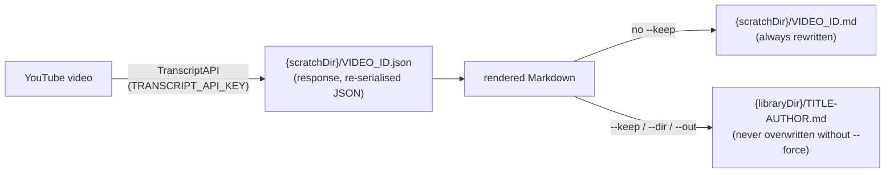

# transcripts/

Fetch a YouTube video's transcript through TranscriptAPI and write it to disk, so the assistant never retypes transcript text into a file and never holds a whole transcript in context. A scratch copy answers questions from a slice of the file; `--keep` files a permanent Markdown copy in the content library.

Off by default: nothing runs it on a schedule, and without `TRANSCRIPT_API_KEY` (and the `jeeves-transcripts` skill) nothing invokes it.

| Script | Description |
| --- | --- |
| `fetch-video.ts` | Runnable `transcripts-fetch-video`, on demand only (no manifest). Without `--live` it reports what it would write and writes nothing. |

## transcripts-fetch-video

```text
jeeves-scripts run transcripts-fetch-video <video-url-or-id> [--keep] [--dir DIR | --out FILE] [--force] [--live]
```

| Flag | Effect |
| --- | --- |
| `<video-url-or-id>` | A bare 11-character id, or a `watch?v=`, `youtu.be/`, `/shorts/`, `/embed/` or `/live/` URL. |
| `--keep` | File it in the library: `{libraryDir}/<title-slug>-<author-slug>.md`. Without it, a scratch copy: `{scratchDir}/<video_id>.md`. |
| `--dir DIR` | Library directory override (implies `--keep`; the file name is kept). |
| `--out FILE` | Exact output path (implies `--keep`). Not with `--dir`. |
| `--force` | Overwrite an existing kept file, and refetch instead of using the cache. |
| `--live` | Write the files. Without it, everything is computed and reported (`dryRun: true`) and nothing is written, not even the cache. A dry run with no cached response still calls TranscriptAPI (one credit) to compute the report, and caches nothing, so a following `--live` run calls it again (a second credit). The skill always passes `--live`. |

It prints one JSON line and never the transcript text:

```json
{
  "ok": true,
  "kept": true,
  "cached": false,
  "dryRun": false,
  "path": "/base/content/library/video-transcripts/talk-title-channel.md",
  "video_id": "dQw4w9WgXcQ",
  "title": "Talk title",
  "author": "Channel",
  "length": "1:02:05",
  "segments": 812,
  "words": 10342
}
```

| Exit | Meaning (`{"ok":false,"error":…}`) |
| --- | --- |
| 0 | Written (or, without `--live`, would be). |
| 2 | Usage: no video, an extra argument, no id in the input, or `--out` with `--dir`. |
| 3 | No transcript: the video doesn't exist or has no captions (HTTP 404). |
| 4 | API or other error: `TRANSCRIPT_API_KEY is not set` (with no cached response), a failed request, another HTTP status (with the status and the first 200 characters of the body), a body that isn't JSON, or a response without a transcript or metadata. |
| 5 | `file exists; pass --force to overwrite or choose --out` (with `path`). |

An unknown option, or `--dir`/`--out` without a value, is refused by `run` before the runnable starts (exit 1, as for every runnable that declares its flags). `run transcripts-fetch-video --help` prints the usage and exits 0 without a network call.

## Data flow



1. A named `--out` that exists without `--force` exits 5 before any network call.
2. **Cache**: `{scratchDir}/<video_id>.json`. Present (and parseable) without `--force`: reused (`cached: true`): no credit spent, no key needed.
3. **Fetch**: `GET https://transcriptapi.com/api/v2/youtube/transcript?video_url=<id>&format=json&include_timestamp=true&send_metadata=true` with `Authorization: Bearer <TRANSCRIPT_API_KEY>` and `User-Agent: <transcripts.userAgent>`, a 60-second timeout, and one retry after 2 seconds on HTTP 408 (the `@karmaniverous/jeeves` retry helper). With `--live` the response is cached before rendering: the parsed JSON body, re-serialised (`JSON.stringify`), not the response bytes, so whitespace and key escapes may differ from what the API sent while the data is the same. A later run (keeping a video first fetched as a scratch copy, say) then spends no credit. A dry run caches nothing (above).
4. **Render**: YAML frontmatter (`title`, `author`, `author_url`, `source`, `video_id`, `length`, `language`, `type: video-transcript`, `retrieved`, `retrieved_via`), a header with the source and author links and the length, a note that the captions are auto-generated, and one `[m:ss]` (or `[h:mm:ss]`) line per caption segment, whitespace collapsed.
5. **Write**: a kept file that exists without `--force` exits 5 (after the fetch: the response is cached by then). The directory is created as needed. No redaction: the watcher redacts secrets at index time (Decision 70).

Re-running with the same video and no `--force` reuses the cached response and refuses to overwrite a kept file; a scratch run is always safe to repeat.

## Configuration

The optional top-level `transcripts` block (`transcriptsSchema`, [config](./config.md)). An invalid value fails `config check` and every run (Decision 76).

```json
"transcripts": {
  "libraryDir": "/base/content/library/video-transcripts",
  "scratchDir": "/base/state/transcripts",
  "userAgent": "acme-assistant/1.0"
}
```

| Key          | Default                                    | Rules          |
| ------------ | ------------------------------------------ | -------------- |
| `libraryDir` | `<default silo>/library/video-transcripts` | Absolute path. |
| `scratchDir` | `{stateDir}/transcripts`                   | Absolute path. |
| `userAgent`  | `jeeves-scripts/<instance.name>`           | Non-empty.     |

`TRANSCRIPT_API_KEY` is an environment variable, never a `jeeves-scripts.json` value. The `jeeves-transcripts` skill declares it as its primary env, so OpenClaw keeps it in the skill's own entry (`skills.entries.jeeves-transcripts.apiKey`, a SecretRef) and passes it to the runnable the skill invokes.

## Prerequisites

- A TranscriptAPI key (billed per credit) set as the `jeeves-transcripts` skill's API key.
- The watcher indexing `libraryDir`, so kept transcripts are searchable.

## Key Files

| File | Purpose |
| --- | --- |
| `fetch-video.ts` | The runnable: flags, the key from the environment, the JSON line and the exit code |
| `lib/file-transcript.ts` | The run: usage checks, cache, API call and retry, exists/force rules, write |
| `lib/youtube-id.ts` | URL or bare id to the video id |
| `lib/render-markdown.ts` | Response to Markdown, the file-name slug, the counts |
| `lib/paths.ts` | Cache, scratch and kept paths |
| `../config/transcripts-schema.ts`, `../config/transcripts.ts` | The `transcripts` block and its resolved defaults |
